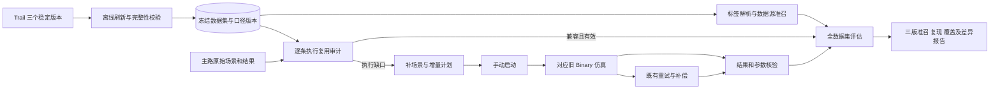
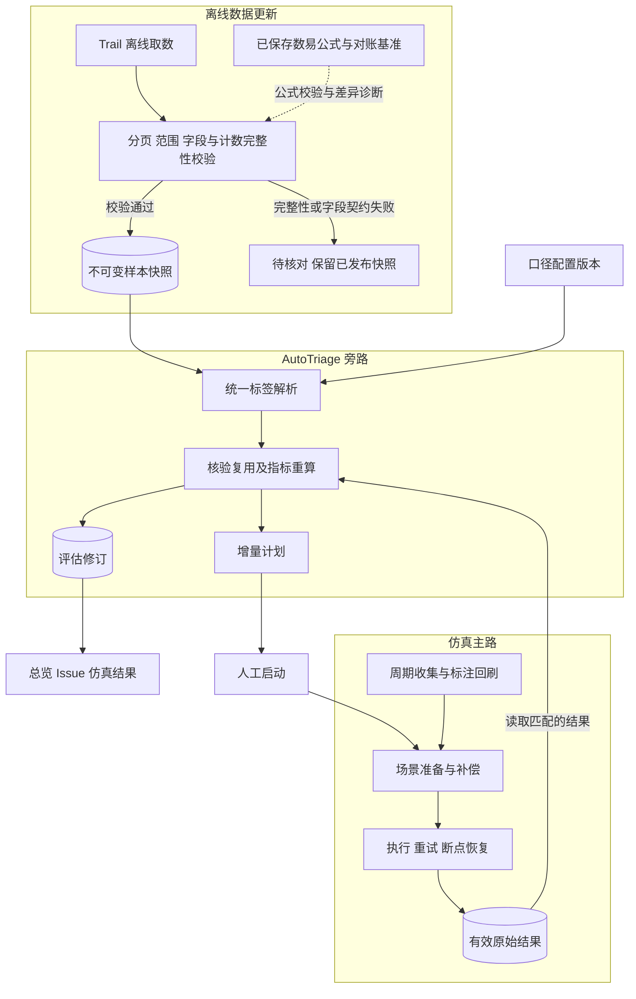
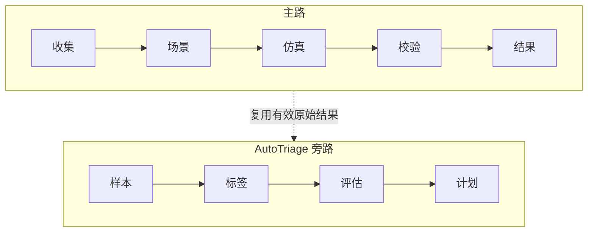

# AutoTriage 人工复核口径与仿真旁路实施计划

更新时间：2026-11-16，Asia/Shanghai。

后续数据源更新：生产在后续工作中接入了 10-30 预览。2026-11-16 已按授权追加 `cn37747655` 的 RD 来源修订；TE 随后也由“无需协助”更新为“成功”。15:36 独立验证生产快照及 HTTP 已生效，最终标签为“成功”、命中 TE。两种标签进入相同计数集合，全部公开指标不变。1,563 条范围保持，1,411 / 1,415 有效结果覆盖，4 条缺结果保留。历史三版冻结结果与发布证据未改；本次没有新增仿真或部署。详见 [RD 历史回执](/Users/didi/workspace/ra_tools/reports/auto_triage_rd_source_refresh_20261116/REPORT.md)及 [TE 更新验证](/Users/didi/workspace/ra_tools/reports/auto_triage_te_source_verify_20261116/REPORT.md)。

## 当前执行与发布状态：稳定三版本数据集与仿真

**当前状态：已完成评估并正式上线。** 2026-11-10 14:57（上海）发布后端 `review-trail-20261110-0a2c82fcf870`，15:21 发布前端验收修正 `review-trail-20261110-0a2c82fcf870-ui1`。生产 AutoTriage 默认口径已切为 `auto_triage_review_v1`，显式旧链接保留 `auto_triage_sql_v2` 含义；普通仿真仍为默认入口。用户本轮明确要求进入评估并上线，正式发布已获授权且已执行。

2026-11-10 冻结 5,862 条已确认样本，另有 1 条平台待核对；有效评估 5,216 条，复用 5,211 条旧结果并新增 4 条成功结果，最终覆盖 5,215 条。剩 1 条缺 bag、4 条时序边界待核验。10-23 为 1,876 条，较规划快照增加 3 条，以本次冻结清单为准。

新 Job：10-09 `49750703`（1 个场景）、10-16 `49750707`（3 个场景），均完成并通过质量与参数校验；10-23 无执行缺口。5,215 个独立 Scenario 标签已追加、回读并验证反向检索。本次生产发布只迁入已完成结果与标签回执，没有再次提交仿真或平台标签写入。独立 SQL 四项计数与评估一致，旧执行哈希不变；正式候选后端 386 项、前端 99 项通过，前端验收修正再次通过 99 项及构建。

正式发布前使用生产 PostgreSQL 副本演练迁入和激活；20 个普通版本以及三版旧口径指标保持一致。人工触发时序策略按 release + profile 隔离并沿口径继承链解析，避免新口径影响普通仿真；既有全局策略保持原值。发布后 20 个普通版本 HTTP 指标无差异，8 个服务子进程均 RUNNING，主路重试、补偿、标签回刷及原调度配置保留。

候选外部 Chrome 已覆盖 320 / 390 / 1440px 代表组合；正式域名另以真实 SSO 在独立 Chrome 窗口完成默认口径、数据库重算、Issue 详情/分页/深链刷新、React Flow 与旁路结果验收。生产页面重算 15:15:11–15:15:14 完成，`source_mode=database`，未请求数易。回滚默认指针和新增检查开关已在副本演练，生产未回退。生产验收的桌面截图不能代替手机真机、所有语言主题或所有控件验收。原始逐条证据留在 cloud_server；历史数据集报告见 [DELIVERY.md](/Users/didi/workspace/ra_tools/reports/auto_triage_stable_dataset_20261110/DELIVERY.md)，正式版本、指标、截图和备份见 [RELEASE_REPORT.md](/Users/didi/workspace/ra_tools/reports/auto_triage_production_review_20261110/RELEASE_REPORT.md)。

| 版本 | 样本数 | 结果覆盖 | 仿真准确率 | 仿真召回率 | 已核验复现率 |
| --- | ---: | ---: | ---: | ---: | ---: |
| 10-09 | 1,967 | 1,709 / 1,710 | 47.16% | 77.28% | 89.16%（1,522 / 1,707） |
| 10-16 | 2,019 | 1,791 / 1,791 | 41.58% | 75.09% | 91.40%（1,636 / 1,790） |
| 10-23 | 1,876 | 1,715 / 1,715 | 40.87% | 79.52% | 91.02%（1,560 / 1,714） |

上线与回滚目录为 cloud_server 的 `/volume/home/workspace/ra_auto_triage/reports/auto_triage_production_review_20261110`；保存正式迁入前应用备份、PostgreSQL dump、旧指针、迁入台账及 `rollback.py`。回滚保留新增样本、完成任务和审计，不用旧整库覆盖后续有效结果。10-16 整窗仿真召回仍较同样本路测高 5.72 个百分点，如实保留。

### 范围与执行方式

本轮仅使用 **10-09、10-16、10-23** 建立冻结的 AutoTriage 仿真评测数据集。10-30 保持未定版预览，留在本轮数据集和新提交任务的范围之外；它原有主路调度不因本轮计划被停止。

推荐方式为：**冻结完整数据集 → 审计并复用兼容的旧结果 → 为剩余缺口补场景和仿真 → 对整个有效集合重新评估**。数据集保留全部符合筛选的 Issue 及真实标签分布，并非只保存补跑的几条。

本计划以“复用 + 增量补跑”编排。如果用户审阅后选择“全部重新执行”，改为基于同一冻结数据集逐版新建全量任务；旧执行仅作对照，不混入该轮新任务结果。未选择全量重跑时，不把增量计划自动扩大为全量重跑。

| 版本 | 已确认平台的 Issue | 参与准召的有效 Issue | 可复用结果候选 | 待补场景 Issue 初估 | 对应旧 Binary |
| --- | ---: | ---: | ---: | ---: | ---: |
| 10-09 | 1,967 | 1,710 | 1,708 | 2 | 1825849 |
| 10-16 | 2,019 | 1,791 | 1,788 | 3 | 1834361 |
| 10-23 | 1,873 | 1,713 | 1,713 | 0 | 1844137 |
| 合计 | 5,859 | 5,214 | 5,209 | 5 | 按版本分别绑定 |

这些是 **11-09 19:21 Trail 快照与既有物理执行副本的静态规划估算**，尚未执行新数据集预检。9 条新纳入有效样本具有匹配场景、冻结物理输入和可用结果的复用候选证据；仍须在正式执行前重验原始产物、任务关联和运行参数。1 个 Issue 可对应多个 Scenario，5 条 Issue 不等于 5 个最终仿真任务。10-09 另有 1 条平台未知，单列待核对，当前不计入上表。

当前 5 条待补场景候选为：10-09 的 cn36861409、cn37058791；10-16 的 cn37104323、cn37244961，以及 Trail 范围新增的 cn37105667。它们来自已有证据，不是已经提交的补跑清单。此前数易集合的缺口为 2 / 2 / 0；切换为 Trail 集合后 10-16 增加 1 条，不能沿用旧的“共 4 条”结论。

### 按顺序执行

| 步骤 | 获得执行指令后开展的工作 | 可审阅产物与验收条件 |
| --- | --- | --- |
| 1. 完成 Trail 入库入口 | 在现有隔离候选中补齐真正的 Trail 导入及来源台账；将内部完整性校验与严格双源诊断分开；原口径字段缺资料时单列不可用 | 相同内容重复导入无副作用；分页不全、必需字段不可用或计数矛盾不能覆盖有效快照；页面 GET 无上游请求 |
| 2. 刷新并冻结三版数据 | 通过后台签名接口分别取三版，沿用已核实日期及业务筛选；检查分页总数、唯一 ID、字段与观测时间，比较新增、变化和退出 | 每版不可变样本快照、差异清单、数据集 manifest 和 SHA-256；数量有变化则逐项解释，不凑齐旧数量；取数期间发生变化则有界重读并保留原因 |
| 3. 解析标签并核算数据源指标 | 用可插拔函数解析 TE → RD → Auto → TO，保存命中来源和原值；计算四个独立分子分母、三分类分布及自/人工分布 | 独立 SQL 核算与统一函数逐条及汇总一致；三版指标基线重新绑定本次冻结快照；必要字段未知的记录单列 |
| 4. 审计已有仿真结果 | 按本轮数据集逐条核对 Binary、driver、仿真参数、trip、锚点、窗口、Scenario revision、任务和有效产物；保留旧批次审计哈希 | 可复用 / 需场景 / 需仿真 / 缺源数据 / 需人工核对的最终计划；旧执行哈希保持不变；重验上表 5,209 条候选及实际缺口 |
| 5. 准备缺口场景与平台标签 | 仅为缺口准备场景；检查 bag、时间窗和主路来源标签；生成独立 AutoTriage 可检索标签集。平台写入先做小批验证，再追加独立命名空间标签 | Issue → Scenario 映射、场景 revision 与窗口、缺 bag 清单；保留全部原标签、物理内容及输入标识；反向查询可找到本轮标签集 |
| 6. 手动启动已生成的增量计划 | 按审核后的执行模式逐版提交，仅启动仍需要的任务；没有缺口的版本仅重算指标。启动前再核对计划有效性和幂等标识 | 记录计划 ID、实际 Binary、Job/Task ID、运行参数摘要和提交回执；Cron 不静默提交新旁路任务。任务进入执行后沿用主路既有重试、补偿和恢复 |
| 7. 回收与全数据集评估 | 校验新结果的运行参数、成功状态和既有质量门槛，解析原始 sim_triggered；把新结果与审计通过的旧结果归入同一冻结评估修订 | 输出数据源 P/R、仿真 P/R、复现率、覆盖率、标签分层和逐条差异。缺结果不算未触发/FN；覆盖未齐时只标已覆盖样本指标 |
| 8. 验收与交付 | 验证三版上下文、原始字段及来源图、复现判定和 Scenario 查询；在独立 Chrome 任务窗口验收候选，检查页面只读数据库 | 冻结数据集 manifest、最终增量计划、执行回执、指标报告与截图；说明真实覆盖范围。数据集执行与生产发布分开；后者已按用户随后明确的上线指令完成 |

### 本轮固定口径与仿真约束

- **来源与范围：** Trail view 1000，按 create_time 转上海日期；首次沿用 2026-09-30 至 2026-11-08（含结束日）、PT + SOP（7/8）、ODD2、Daily Cruise/稳定版本测试、release、is_deleted=0、自触发或人工触发。保持三版完整分布，不增加旧主路 abnormal_behavior 限制，不按数易缺少的 ID 另设黑名单。范围外新增记录只列差异，修改本轮日期范围须先写入 manifest 的新修订。
- **数据集内容：** 每条保存版本、日期、平台、触发类型、四路标签原值及可用状态、最终标签及命中来源、四项计数成员、物理输入、来源观测时间。Manifest 绑定样本哈希、口径配置及解析函数版本、Scenario 清单、执行参数哈希和复现判定版本。
- **冻结与更新：** 稳定版本也需在实际执行时刷新一次再冻结。后续 Trail 更新产生新快照和差异，不覆盖已用于仿真的数据集；本轮冻结集不因 Cron 后续取数而静默改变。
- **旧参数基线：** 各版本分别绑定上表旧 Binary 及其已审计运行参数，driver 为 orion-release-v1；新补跑沿用 prod_gen4、NORMAL、并发上限 1000、DPE 开启、仿真缓存关闭、recovery_mode=baseline。执行前逐项与主 Job 回执核验，不加入实验 Binary 1860573 或新的 warmup / feature-history / 人工信号策略。
- **复现与准召：** 准召保持整窗及四个独立 SQL 集合，字面“正确触发”不改成“成功”。人工样本按此前确认的人工前/后时序规则评估复现；核对三版时序证据与策略版本，缺失单列待核验，跨版本报告不混用不同复现判定含义。原始仿真触发结果不因评估口径变化被改写。
- **Scenario 标签：** 独立标签集绑定数据集、口径与评估修订；允许与主路场景重合，追加可检索标签，并保持主路原标签。未验证的关联或待核对记录不标成已同步成功。
- **执行数量与失败处理：** 正式启动以步骤 4 / 5 生成的清单为准。缺 bag 或字段未知只阻断对应记录，其他已确认记录继续；未齐部分保留清单与状态。主路已存在的运行、重试和标签回刷保持原有契约。

### 预期链路

### 已确认的执行方式

用户已确认“完整数据集评估、兼容结果复用、缺口补跑”，实际冻结为 5 个 Issue 缺口；最终完成 4 个场景补跑，另 1 条缺 bag 保留。没有缺口的 10-23 只重算指标。数据集执行阶段没有隐含发布；用户随后明确要求上线，已据此完成生产切换。

---

保留统一仿真页面和普通仿真默认入口，选择 AutoTriage 时使用与数易看板一致的人工复核口径。标签通过统一、可插拔的解析函数计算，样本离线入库，主路结果经核验后复用，新增执行缺口先生成计划再由人工启动。

数易四版本 SQL 核算已通过；隔离候选的解析、真实数据重放和 UI 自动化已完成。按用户明确的主、副链路同源方向，旁路日常数据源采用 Trail；数易用于公式校验及差异诊断，不再要求每次更新与数易当前快照逐条相等。2026-11-10 已完成 Trail 导入、稳定三版补跑及正式生产发布；10-30 不纳入本次新人工复核数据集。

## 目标与交付边界

- 普通仿真与 AutoTriage 共用场景准备、仿真执行和原始结果，AutoTriage 保持明确旁路。
- 总览、Issue 明细和仿真结果共用一个评估口径上下文；页面不复制成两套。
- 当前目标为数易的“自触发准确率_AutoTriage_人工复核”和“自触发召回率_AutoTriage_人工复核”。保持整窗召回含义和既有复现判定策略。
- 主、副链路统一使用 Trail 签名接口离线取数；数易保留为计算公式校验和范围、更新时刻差异的诊断基准。页面读取、筛选、翻页和口径重算只读取数据库，不要求用户提供数易登录态。完整分页、唯一 ID、必需字段、NULL 语义和数据库内逐条及汇总计数必须通过校验；Trail 与数易的跨时刻样本集合相等不再是日常更新硬门槛。
- 口径、样本快照、评估修订和执行记录分别版本化，标签变化不会覆盖原始执行结果。
- 新优先级、新样本和仿真缺口先预览再发布或启动；普通主路已有重试、补偿和恢复机制继续运行。

## 已核对的数易基线

取数时间为 2026-11-09 15:28:47，时区 Asia/Shanghai。报表为 288969，人工复核组件为 11214491。筛选条件为 create_date 2026-09-30 至 2026-11-08，含结束日；GEN4_PT 与 GEN4_SOP；ODD2；Daily Cruise/稳定版本测试；release版本；is_deleted=0。其他全局筛选保持全部。

下面的样本数为两项指标涉及的自触发与人工触发 Issue 总数，分别在各指标内使用 COUNT DISTINCT issue_id 计算分子、分母。

| 版本 | Issue 样本数 | 准确率分子与分母 | 人工复核准确率 | 召回率分子与分母 | 人工复核召回率 |
| --- | ---: | ---: | ---: | ---: | ---: |
| 10-09 | 1,960 | 633 / 1,432 | 44.20% | 787 / 1,060 | 74.25% |
| 10-16 | 2,007 | 574 / 1,455 | 39.45% | 750 / 1,082 | 69.32% |
| 10-23 | 1,868 | 580 / 1,479 | 39.22% | 762 / 996 | 76.51% |
| 10-30 | 911 | 466 / 678 | 68.73% | 488 / 665 | 73.38% |

四个版本合计 6,746 条；当前筛选下全部版本相关 Issue 为 9,374 条。逐条成员标记、版本数量及两项准召分子分母的独立核算差异均为 0。该基线绑定此次取数时刻及筛选条件，更新后须重新对账。

10-23 旧快照为 1,871 条，本次为 1,868 条。cn37478115、cn37484613、cn37484633 的 ODD 从 ODD2 改为 ODD3，因而退出当前筛选。更新任务必须处理这类退出，不得只追加新样本。

### Trail 替代路径核对进展

已通过后台签名接口获取 Trail 完整分页，无需数易登录或浏览器。`2410` 视图会隐藏相关 Issue；通用 `1000` 视图完整覆盖数易样本。创建日期按 Trail `create_time` 的上海日期转换，日期和触发类型无差异。PT/SOP 的已知平台值对应 7/8；另有 1 条 Trail platform 为空，数易为 PT，保持待核对，未按版本或车号推断。

补齐了数易四路原值及每个字段的 SQL NULL 标记。较新数易查询完成于 2026-11-09 19:19:40（上海），Trail 标签取数完成于 19:21:05。数易 10-30 比 15:28 基线多纳入 1 条，现合计 6,747 条；原基线和新快照分别保留。

| 版本 | 数易新快照 | Trail 1000 | Trail 额外 | 数易缺失 | 同一批样本的四路原值与准召 |
| --- | ---: | ---: | ---: | ---: | --- |
| 10-09 | 1,960 | 1,968 | 8 | 0 | 标签与四项计数一致；1 条平台待核对 |
| 10-16 | 2,007 | 2,019 | 12 | 0 | 标签与四项计数一致 |
| 10-23 | 1,868 | 1,873 | 5 | 0 | 标签与四项计数一致 |
| 10-30 | 912 | 913 | 1 | 0 | TE、RD、TO 一致；55 条模型原值不同，39 条最终复核标签不同 |

10-30 同集合数易准召为 68.73% / 73.38%，Trail 为 64.75% / 72.90%。两端更新时刻与数仓物化周期不同；Issue 最后修改时间不能充当模型字段的生效历史，当前不将所有差异直接归因于刷新延迟。

Trail 多出的 26 条均为 MULTI-RELAY 通道，但数易还正常纳入了该通道的 280 条，因此不能整体排除该通道。26 条中，自触发 18、人工触发 8；按当前人工复核计数规则，10 条参与至少一项准召计数，16 条不参与。22 条已存在于普通仿真采集快照中。已读数据集底表 JOIN、分区、展开条件及末尾 SQL；尚不能完全解释数仓的成员差异，未使用固定 ID 黑名单。

按用户最新明确的主、副链路同源方向，这些范围差异作为诊断结果保留，不再因此阻断 Trail 数据源接入；符合已配置 Trail 筛选与字段契约的记录可以纳入旁路。生产数据源、默认口径和调度尚未修改。

可复查脚本为 `reports/auto_triage_review_policy_20261109/verify_raw_trail_shuyi.py`，汇总报告为同目录 `TRAIL_SHUYI_RECONCILIATION.md`。候选提供离线 `verify-trail` 命令；有范围、字段、NULL、平台或计数差异时返回 pending 和非零退出码 2，只保存权限 600 的新证据文件，不修改数据库或启动仿真。

### 主、副链路同源后的实施决定

2026-11-09 只读核实生产：主路采集和标注回刷均读取 Trail；主路配置为 view 2410、issue_time 和原有异常行为筛选，采集及标签回刷开关均启用。旁路采用同一个 Trail 服务，按已验证的 view 1000、create_time 的上海日期、PT + SOP 等自身条件取数，不照搬主路会缩小 AutoTriage 范围的异常行为筛选。共享数据服务不要求两个评估范围完全相同。

- 旁路离线任务从 Trail 获取原始字段，入库后按配置解析 TE → RD → Auto → TO，保存独立的来源与观测时间，并复用主路兼容的场景和原始结果。
- 保持数易四个独立计数集合和整窗准召语义；按数易快照核算时仍须复现该快照的原值和计数。Trail 最新快照单独标明来源和时刻，不宣称其数量或结果与数易物化快照逐条相同。
- `verify-trail` 的严格双源比较保留为诊断工具。范围差异和有依据的标签更新不再直接否决正常 Trail 导入；上游不完整分页、字段不可用、冲突、无法解释的枚举与计数自相矛盾仍须拦截。
- 平台等必要字段无法确定时，将受影响记录单列待核对，已确认记录继续入库评估；不能猜测字段，不能将待核对或缺结果记录当作未触发/FN，也不能把已确认子集称作全部样本齐备。
- 历史数易快照、旧修订与原口径来源保留。Trail 新快照不得把未取得的数仓原口径列伪装成 SQL NULL 或用其他合并字段顶替；原口径对照缺少证据时单列不可用。
- 页面 GET 只读数据库。沿用后台调度更新样本和评估；新增执行缺口仍只生成计划并等待人工启动，原主路重试和恢复继续生效。

2026-11-10 已实现 Trail 原生导入及台账，将上述内部完整性校验与严格双源诊断分开，并完成三版候选与生产验收；生产已切换为本次数据集与人工复核默认口径。`verify-trail` 继续作为双源诊断入口。

2026-11-10 用户明确 10-30 尚未最终确定：该版本指标保留为动态预览，绑定数据源和观测时间，继续按后台更新任务刷新；待样本与标签稳定并达到验收条件后再冻结定版快照。评估是否定版独立于主路采集结束及 Job 完成，不能据此取消主路重试、补偿和标签回刷。本次双源较大准确率差异已拆解为 21 条自触发转误触发、6 条转字面“正确触发”，分子净减少 27，分母保持 678；细节见对账报告。

## 指标公式与标签语义

令 L 为当前口径解析出的最终标签。四个集合独立计算，均去重 Issue ID，并保持未删除条件。

| 项目 | 计数条件 |
| --- | --- |
| 准确率分子 | 自触发且 L 属于 成功、失败、无需协助、限制使用 |
| 准确率分母 | 自触发且 L 不属于 out_of_scope、未接起、未填写 |
| 召回率分子 | 自触发且 L 不属于 误触发、out_of_scope、未接起、未填写 |
| 召回率分母 | 自触发或人工触发，且 L 满足同一召回排除条件 |

准确率和召回率分别由各自分子除以各自分母计算，不能共用一个 TP 近似两个分子。“正确触发”保留字面值，当前不进入准确率分子，但可能进入召回正例。来源图的展示分类不反向修改这些计数集合。分母为零时展示无可计算值。

当前只有 SQL NULL 才继续向后兜底；空字符串、“未填写”、字面减号等非 NULL 值遵守原 SQL，不自行跳过。读取数易展示结果时使用 IS NULL 标记还原 NULL，避免把占位显示当作原值。

## 可插拔标签解析

统一入口为 `resolve_label(sample, policy) -> LabelResolution`。这是无网络、无数据库写入的确定性函数，按配置顺序选择标签。返回最终字面标签、命中来源、口径版本、原始结果修订及解析状态。指标、来源图、Issue 明细和 Scenario 标签共用该结果。

| 口径配置 | 优先级 | 启用条件 |
| --- | --- | --- |
| 本次默认口径 | TE → RD → Auto → TO | 原始字段语义与数易公式验证、Trail 快照内部校验及候选预览通过后启用 |
| 后续预留口径 | 复核 → TE′ → TE → RD → Auto → TO | 新来源接通、规则明确并完成预览对账后启用 |

配置拆分为样本筛选、标签优先级和四项计数规则三个部分，由不可变口径版本统一引用。来源使用登记过的标识与适配器；调整顺序发布新配置版本，新增来源增加适配器。配置中不接受任意可执行 SQL 或代码。

来源图按有效配置生成分支，既不固定为四路，也不固定为六路。历史口径继续按原配置和输入快照解析。

- 首个已知非 NULL 值命中即停止；全部来源明确为 NULL 时返回空标签，并按 SQL 三值逻辑计数。
- 高优先级来源缺字段、无法读取或存在未裁决冲突时返回待核对，不能当成 NULL 越过。
- 复核尚未发生时，适配器须提供明确的未标注状态；它与来源尚未接通分开记录。
- 不按最近写入时间自行裁决多次复核；按上游确认的生效规则及修订读取。
- 配置发布前生成标签变化、有效样本变化、指标变化和执行缺口预览；发布与默认切换作为可审计动作。

## 来源适配与快照字段

| 来源 | 本次接入依据 |
| --- | --- |
| TE | 数据集中的 ra_review_result_new 原值 |
| RD | 数据集中的 ra_rd_review_result 原值 |
| Auto | 数据集中的 ra_stuck_auto_result 原值 |
| TO | 数据集 COALESCE 末级实际采用的原 RA 结果名称，核对 RaResultConfData.all_nodes_name 及其枚举映射 |
| 复核 | 预留适配器，实际字段与生效修订规则接通后登记 |
| TE′ | 预留适配器，实际字段与旧 TE 的分离契约接通后登记 |

TO 不直接用 merged_ra_result 或 Trail ra_merge_result 替代。当前权威合并列 merged_ra_rd_result 必须保留，并与统一解析函数的结果逐条核对；merged_ra_auto_result 和原口径列也保留用于历史比较。

快照保存各来源原值、NULL 标记、字段可用状态、上游修订与观测时间，以及 Issue ID、create_date、版本、平台、触发类型和完整筛选条件。Trail 适配器离线读取标签与物理字段，经同条件核对后接入；Trail 观察与数易观察分别留存，不能将当前 Trail 标签冒充某个历史时刻的数易快照。

现已补齐完整 TE、RD、模型和 TO 原值及 SQL NULL 标记；纯函数对数易 6,747 条原始记录的解析与权威合并列一致。Trail 的原值差异单列于上文，未将实时观测冒充历史数易快照。Cooper 文档明确未来顺序，但未给出复核与 TE′ 的真实字段名、多次复核冲突规则及空值处理规则；未来口径在这些契约确定前保持未启用。

## 离线更新与自动化触发

离线更新按版本和日期范围执行：读取上游 → 完整分页与唯一 ID 检查 → 逐条标签与计数核对 → 汇总核对 → 保存不可变快照 → 原子切换该范围的最新指针。重复导入相同内容应无副作用，失败时保留上一次已核对快照。

上游提供可靠变更游标时可增量获取；没有可靠游标时重新读取限定版本与日期的完整范围，再计算新增、修改和退出差异。退出筛选或删除的 Issue 从新快照统计中移除，历史快照保留。

| 触发事件 | 自动动作 | 仿真动作 |
| --- | --- | --- |
| 首次导入或显式更新样本 | 对账、入库、评估重算和计划更新 | 新缺口等待人工启动 |
| 已配置的后台样本更新任务 | 采用相同离线入口和校验 | 不隐式提交旁路仿真 |
| 修改标签优先级或计数规则 | 使用数据库快照生成新口径预览 | 仅更新缺口计划 |
| 新的有效仿真结果到达 | 校验执行来源并重算相关评估 | 既有执行按原重试策略运行 |
| 打开页面、筛选、翻页 | 读取已保存结果 | 不产生执行副作用 |

样本更新任务和评估任务按范围加锁、去重并限制并发。口径缺必需字段时明确返回需更新样本字段。后台调度沿用现有服务端机制，不建立聊天提醒或另一套常驻调度。

## 仿真结果复用与增量执行

复用原始 sim_triggered，不复用旧口径的 TP、FP、FN。复用前核对 Binary、simulation 与 driver 参数、Issue trip 和锚点及窗口、Scenario ID 与 revision 及窗口、任务关联与有效产物。沿用各版本已验证的旧仿真方式，实验 Binary 1860573 的结果不混入本次看板。

一个 Issue 的全部必需场景都有有效结果后，任一场景触发才记为该 Issue 已触发。缺结果或执行不明单列覆盖缺口，不记作未触发或 FN；部分覆盖与完整仿真指标区分展示。

增量计划至少分类为可复用、需补场景、需仿真、待补源数据、需人工核对，并绑定样本快照、口径版本和执行条件的哈希。启动前重检计划是否过期，并使用幂等标识防止重复提交。

人工启动约束针对旁路新产生的执行缺口。任务启动后，主路已有的失败重试、场景补偿、断点续跑和结果恢复机制继续生效；普通主路的既有自动化行为保持原契约。本次口径迁移不改整窗召回和已有人工触发时序判定。

## 后台完整链路

样本快照与口径配置共同决定标签，标签与有效原始结果共同决定评估修订。页面只读取修订；缺口计划通过人工启动重新进入共用场景和执行链路。失败重试、补偿和恢复封装在主路已有阶段中。

## React Flow 展示与页面组织

展示主路与旁路，逻辑连接如下。主路既有重试、回刷和补偿泳道保留常驻可见，详细取数与字段解析放在节点详情中。

- 主路始终保留收集、场景、仿真、校验、结果；补偿、标注回刷与重试入口和异常数量常驻可见。展开时使用独立泳道，回边沿外侧走线，不穿过 AutoTriage 节点。
- 旁路默认只展示样本、标签、评估、计划。标签节点显示当前口径名称，详情展示优先级和来源；不在每个页面平铺 SQL 版本和样本日期表单。
- 节点默认只放名称、数量或进度、简短状态。运行路径流动；等待、已完成、受阻和未知状态各自展示，完成状态不会持续假装运行。
- 仿真页保持一个流程图。下方沿用结果区域的普通仿真与 AutoTriage 内容切换，不再新增一层顶部导航。
- 总览和 Issue 明细沿用共享评估口径下拉；普通仿真保持默认，选 AutoTriage 时采用当前生效人工复核口径。高级规则管理放设置。
- 来源分析继续位于 AutoTriage 总览最后。默认展示各来源数量、占比和现有三分类分布；公式、原始标签和计数详情折叠。
- 显式携带旧 profile 的历史链接保留含义并显示历史口径名称；缺省 profile 使用当前生效版本。翻页、切语言和主题保留上下文。

Scenario 平台独立可检索标签沿用现有标签集契约，关联口径版本和评估修订。与原标签可以重合，保持独立命名和检索入口；显式同步批次负责平台写入，页面 GET 不改平台标签。

## 实施阶段与依赖

- [x] P0 核对生产基线与数易口径。历史四版本 6,746 条样本、逐条标记及分子分母已对齐；随后按 Trail 三个稳定版本重新冻结本次数据集。
- [x] P1 建立解析契约与来源适配。配置校验与纯函数已上线；TE / RD / Auto / TO 映射已核实，未来复核和 TE' 两路保留未启用状态；NULL、缺字段、优先级覆盖与冲突测试通过。
- [x] P2 升级快照与离线导入。Trail 原生离线导入、PT/SOP 筛选、来源和观测台账已完成；内部完整性与双源诊断分开。新旧筛选及默认日期独立，旧快照和旧哈希保留。
- [x] P3 生成评估修订。三版冻结 5,862 条已确认样本；有效 5,216 条，旧结果复用 5,211 条，新增成功结果 4 条，覆盖 5,215 条；1 条缺 bag 与 4 条时序边界保留。原批次哈希及物理输入保持不变，10-30 不创建本次新评估集。
- [x] P4 更新页面、来源图和 React Flow。共享控件、分页和口径上下文上线；保留主路重试、补偿、标签回刷和断点恢复。5,215 个独立 Scenario 标签此前已追加并回读，本次发布只迁入回执。去掉复用结果时误导性的空任务卡，减少无效文字。
- [x] P5 完成候选验收。真实冻结数据、后端 386 项、前端 99 项、构建、接口与外部 Chrome 代表视口通过；旧合成 API 的 21 组检查仅作为历史布局回归。生产 PostgreSQL 副本完成迁入、激活、普通指标兼容及回滚指针演练。
- [x] P6 备份并发布兼容版本。2026-11-10 正式迁入并切默认口径；真实登录生产域名完成页面、数据库重算及交互验收，20 个普通版本 HTTP 指标无差异，8 个服务进程恢复；截图、备份和回滚命令见发布报告。

P1 的契约确定后推进 P2 和 P3；候选后端接口稳定后完成 P4；P3、P4 和 P5 通过后进入生产切换。未来六路口径的字段接入单独推进，不阻塞本次已明确的四路口径。

## 代码改动范围

| 模块 | 主要改动 |
| --- | --- |
| metric_profiles 与新增标签解析模块 | 来源登记、优先级配置、规则版本、预览及默认切换 |
| auto_triage_warehouse 与 evaluation_samples | 上游字段、NULL 标记、正式平台筛选、复核计数、快照兼容及离线校验 |
| auto_triage_metrics 与 evaluation_pipeline | 标签投影、原始结果复用、新旧修订及增量计划 |
| evaluation_sources 与 evaluation_worker | 按配置归因、统一计数、数据变更后的定向重算 |
| Scenario 标签集及 API 契约 | 口径版本隔离、来源信息、可检索标签和兼容返回 |
| EvaluationWorkspace 与 Settings 及类型 | 共享筛选上下文、规则编辑、Issue 来源展示和历史链接 |
| EvaluationSources 与国际化 | 动态来源分支、底部图表、中文和英文文案 |
| SimulationFlow 与布局及状态模型 | 两条泳道、详情展开、外侧回边、保留重试与正确动画状态 |

具体以候选差异为准，预计后端约 8–10 个、前端及流程约 10–12 个运行文件。沿用现有快照和评估存储，优先通过字段与内容 schema 升级完成迁移。

## 实施环境与版本基线

实施前从已核对的生产版本制作隔离候选，避免使用过期源码或覆盖工作区其他 Workbench 修改。后端参考 `/Users/didi/workspace/ra_tools/reports/auto_triage_source_chart_20261109/ra_sim_repro_dashboard/backend/`，前端参考 `/Users/didi/workspace/ra_tools/reports/auto_triage_source_chart_bottom_20261109/ra_sim_repro_dashboard/frontend/`，再次与线上文件哈希比对。

发布目标从既有部署配置读取。当前已核对的运行根目录为 `/volume/home/services/ra-sim`，独立源码位于其 source 目录。应用源码、构建产物与运行服务分别核对；前端先上传哈希资源再更新 index，后端受控重启 API 并保证 worker 使用兼容版本。

上游凭据仅供离线任务从既有私有目录读取，不进入浏览器页面、口径配置、公开日志或 Git。更新鉴权失败时保留已核对数据并展示更新状态，页面仍可读取数据库。生产验收检查认证域名的 /sim/ 路由、资源和 API，并覆盖既有入口前缀兼容；匿名跳转或直接后端 200 不代替真实登录验收。

## 验收标准

| 范围 | 必须满足的结果 |
| --- | --- |
| 数易公式与来源诊断 | 在同一份已保存数易输入上复现字面标签、NULL 和四项计数；Trail 采用同一公式，单独报告范围及更新时刻差异，不能将跨时刻结果宣称逐条一致 |
| Trail 导入 | 已配置筛选、完整分页、唯一 ID、来源原值和内部计数一致；新增、修改、退出和待核对记录有台账；允许符合 Trail 契约且未出现在数易快照的记录，不使用固定 ID 黑名单 |
| 标签解析 | 当前四路与数易 COALESCE 一致；未来顺序可配置；高优先级覆盖、全 NULL、空串、正确触发、缺字段和冲突处理均有有效回归 |
| 来源图 | 所有来源与待核对分支之和等于样本总数；各分支计数可加总回总指标；没有通过标签相等猜测来源 |
| 仿真复用 | 执行来源与输入核验完整，旧原始产物及审计哈希保留；缺失结果不记为 FN，不混入实验执行 |
| 增量计划 | 只读更新不会提交新旁路任务；人工启动可追溯、幂等；旧计划过期后不能继续启动；运行中既有重试有效 |
| 只读页面与性能 | 浏览、筛选和翻页不请求数易、不写 Scenario、不启动仿真；总览不额外加载 Issue 明细；记录首屏、切换和接口耗时并与发布前比较 |
| 页面一致性 | 总览、Issue 和结果的口径与数量一致；来源图在底部；历史链接、分页和语言主题切换保留上下文 |
| React Flow | 主路重试、补偿、回刷及断点恢复均可见且可进入详情；默认线路无交叉，展开回边使用独立轨道；动画与真实状态一致 |
| 响应式及可访问性 | 覆盖 320px、390px 和 1440px；中文、英文及深浅主题代表组合；检查长文案、加载、空、失败、弹层及键盘操作 |
| 生产验证 | 在真实登录的外部 Chrome 验证生产域名、三个稳定版本的指标、详情、筛选、历史链接、数据库重算、同步状态和截图；未实际覆盖的控件及设备行为单独记录 |

仿真覆盖未齐的版本展示覆盖与缺口，仅在满足现有发布条件时展示完整仿真曲线。若验收需启动旁路补跑，先展示具体计划并由人工启动；不能为通过验收隐式发起任务。

## 发布与回滚

1. 再次核对实际运行版本、资源、API 和调度状态，记录前后端、口径与快照指针。按独立部署流程冻结本次切换涉及的写入和调度，完成应用包及数据库备份。
2. 先发布可兼容新旧数据与口径的前后端；旧默认口径保持可用。迁移与导入幂等执行，保留逐项变更台账、旧快照和旧修订。
3. 准备本次三个稳定版本的新评估修订，完成数据对账与执行来源校验后原子切换生效 profile。发布配置、缓存及后台 worker 使用同一版本；显式旧链接继续定位旧口径。
4. 在生产域名完成登录态浏览器验收，确认页面只读数据库、指标与观测时间相符、缺口与同步状态准确。核对成功后恢复原调度状态。
5. 回滚先停止本次新增写入并恢复旧生效 profile 与相关指针，再按台账恢复应用资源及 API。保留新旧快照和仿真产物，不用整库回退覆盖并发产生的有效执行记录。

发布目录保存 manifest、应用备份、数据库备份位置、原指针、修改记录、校验结果和回滚脚本。回滚脚本默认只校验，实际恢复使用明确参数。发布记录必须写清实际上线版本、完成的上游更新范围、验收截图和回滚位置。

## 参考资料与交付产物

实施前生产基线为前端 `8759b51+at-sources-bottom-7eefbf088f`、来源图后端 `8759b51+at-sources-2752d9877a`。当前正式后端为 `review-trail-20261110-0a2c82fcf870`，前端为 `review-trail-20261110-0a2c82fcf870-ui1`。

- [数易人工复核指标所在看板](https://bigdata.xiaojukeji.com/analysis_platform_static/board.html#/?type=reportView&reportId=288969&source=market&subReportId=6276081)
- [AutoTriage 指标与标注约定](https://cooper.didichuxing.com/didocs/2210394294430)
- 本地对账：`/Users/didi/workspace/ra_tools/reports/auto_triage_review_count_reconciliation_20261109/REPORT.txt`，同目录的 reconciliation.json、observed-review-formulas.sql、1023-scope-change-proof.json 及私有明细。
- 部署与指标约束：`/Users/didi/.claude/skills/ra-sim-repro-dashboard/SKILL.md` 及其指标映射说明；仓库 AGENTS.md。
- 实施交付：新旧指标与覆盖比较、来源分流对账、增量计划、代码及迁移差异、自动化结果、外部 Chrome 验收截图、上线 manifest 与回滚台账。

只读对账、数据集执行与正式发布分别保留证据。当前三版口径已在生产生效；实际指标、来源比例、补跑与缺口见本文件顶部和正式发布报告。

历史初版候选 `8759b51+at-review-candidate-f8149e04435a` 包含 20 个运行文件变化，曾通过后端 376 项、前端 99 项及合成 API 的隔离 UI 21 组；清单位于 `reports/auto_triage_review_policy_20261109/candidate-manifest.json`。真实数据预览与 Trail 范围差异详见同目录 `TRAIL_SHUYI_RECONCILIATION.md`。之后已完成真实数据集补跑、正式候选 386 项后端检查和生产发布，以顶部现状及正式发布清单为准。

