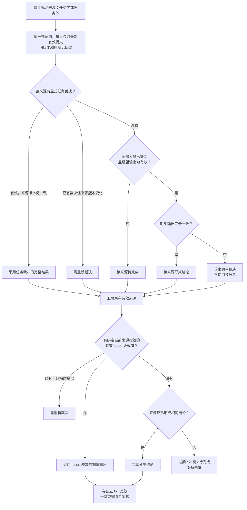
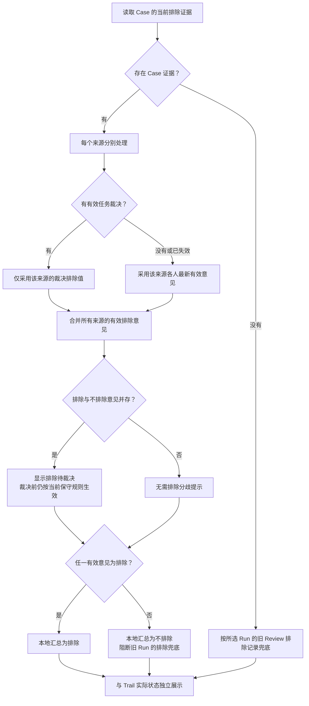

# 当前标注与裁决流程（2026-10-23）

本文以本次代码和实际生效规则为准，供讨论裁决规则使用；没有因为界面增加“待裁决”就改写业务优先级。数据库及 API 内部仍兼容原有枚举，页面统一使用业务名称。

## 先区分四类数据

| 数据 | 作用 | 裁决影响 |
|---|---|---|
| Case 期望输出 | 正确触发 / 误触发 / 无需协助的共享人工结论 | 参与任务内与 Issue 级裁决 |
| Issue Tags 与依据 | 场景、交互、脱困标签及每人的说明 | 原始意见保留；不以 Tags 是否相同决定三分类是否冲突 |
| Case 排除意见 | 该 Issue 是否应排除，独立于模型 Run | 使用有效任务裁决或各人当前排除意见 |
| Run 模型复核 | 对某次模型结果的评价、完成状态和评论 | 不作为 Case 最终分类或排除的覆盖优先级 |

GT 是独立的评测基准；人工裁决只改变共享人工结论。与 GT 不一致会显示需复核，更新 GT 仍需单独预览、确认。Trail 当前标记是另一份外部事实，本地保存和裁决不会自动写 Trail。

## 1. 分类结论如何产生

来源内部状态依次检查：裁决失效 → 人员或输出未齐 → 分类冲突 → 一致形成结论。跨来源则依次检查：过期 → 任一来源冲突或来源结论不一致 → 未完成 → 一致形成结论。历史导入中已确认的冲突也保留，不能被表面一致掩盖。

Issue 级裁决优先级最高，但创建时有边界：所有**任务来源**必须先形成有效结论；任务内未完成、冲突、过期时，必须先处理任务。任务外来源也参与 Issue 汇总，不能因为“自由标注”而自动忽略。任务外未决意见可以由显式 Issue 裁决统一处理。

同一来源的任务裁决只替代该来源，不能自动压过其他来源。不同来源之间不按更新时间选一条，也不按作者身份或管理员身份自动覆盖；普通保存永远是个人意见，只有显式裁决进入裁决优先级。

## 2. 排除如何生效

当前是“任一有效 true 则排除”，不是多数票。“待裁决”提示表明存在 true/false 分歧，未在后台自动替换已有意见。任务裁决为 false 只替代那份任务；若其他有效来源仍 true，Issue 本地汇总仍 true。

**现有结构限制：**Issue 级标签裁决只保存最终三分类，不保存排除决定；当前没有一个能覆盖所有来源的独立 Issue 排除裁决。页面“排除裁决”复用的是**完整任务裁决**：必须同时确认该任务的期望输出、Tags、证据缺口、理由和排除值。可以处理 pending 或同标签但排除意见不一致的任务。它不是仅改一个布尔值的全局裁决。

## 3. 实际操作顺序

1. 查看来源与原始意见，确认是分类分歧、排除分歧，还是只有理由缺失。
2. 需要普通补充时保存自己的意见，保留他人的当前意见。
3. 某个任务来源未完成或冲突：在该任务内完成标注或显式任务裁决。排除分歧从“排除 → 待裁决/详情”进入现有完整任务裁决。
4. 各任务来源形成结论，但跨来源仍冲突：进入顶部同一行的 Issue 裁决，选择最终三分类并填写依据。
5. 提交绑定全部当前来源版本和此前裁决版本；并发变化返回冲突，须刷新来源后重新确认。
6. 后续任何相关来源版本变化，已有裁决需重新确认；历史版本和依据保留。
7. 如要把本地排除和理由发布到 Trail，另走“问题排除 → 选中 → 预览 → 明确确认 → 写入 → 读回”。空理由不会清空远端。

本地改成不排除不会撤销 Trail 中已存在的 true；目前受控 writer 只支持写 true 和理由更新，远端取消排除没有在本次增加。

## 4. 理由来源与状态

优先读取当前生效排除版本的非空 Case 理由。若当前生效的是迁移旧版本且理由空，只关联**它自己 source_annotation_id 对应**的原始排除备注；必须同 Issue、同作者、原记录也勾选排除，并能在迁移后的模型复核理由中逐字核验。不会拿其他作者、任意更旧的备注或 Trail 文本来假造人工提交。新的普通空提交也不会被旧备注覆盖。

这次关联是只读来源恢复：原作者、原时间、原 Review ID 和 Case revision ID 可查；不新增标注、不改变分配、任务进度、裁决来源指纹、GT 或 Trail。审计时45条候选：15条已有理由、18条符合精确来源恢复、12条当前对应原文和 Trail 均空。数字是时点事实，页面不硬编码。

| Trail 与理由事实 | 页面主状态 |
|---|---|
| 排除未生效或未设置 | 待排除 |
| 已排除；理由缺失或两端不一致 | 理由待更新 |
| 已排除；非空理由一致 | 已排除 |
| 查询未完成 / 失败 | 查询中 / 无法确认 |

“理由待更新”可能是本地待补充，也可能是已有非空新理由待提交；只有满足原有安全条件的非空新理由能进入写入集合。已同步保留为内部兼容枚举，页面不再作为主状态名称。

## 5. 适合继续讨论的规则选择

- 排除应继续“任一 true 保守排除”，还是仅在一致/裁决后排除？分歧时是否保持上一次已确认结论？
- 是否增加独立 Issue 排除裁决，并决定它是否覆盖所有任务和任务外来源？
- 是否把任务标签裁决和排除裁决彻底分开，避免修改排除时一并确认分类与 Tags？
- 只改理由、Tags 等无关字段是否也应使分类/排除裁决过期，还是分别维护来源指纹？
- 标签分类一致但排除分歧时，分类完成和排除待裁决是否应分别影响任务完成数？
- 本地不排除但 Trail 仍排除时，谁有权发起远端撤销，如何预览和审计？

上述是待讨论问题，不是已实现的新规则。

代码依据：`app/db_parts/labeling_decisions.py`、`labeling_projection.py`、`labeling_records.py`、`app/labeling_rules.py`、`app/routers/trail_update/selection.py`。
