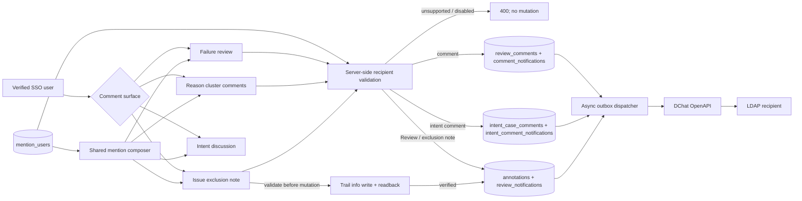

# DChat @mention architecture

`access_users` and `mention_users` deliberately answer different questions.
The former grants Dashboard writer/admin authority; the latter only permits a
username to appear in comment suggestions and receive a DChat notification.
Both are administered on `/users`, but membership in `mention_users` never
grants write access.

The browser fetches only enabled usernames for normal verified users. It is a
convenience layer, not the security boundary. Candidates stay hidden until the
caret is inside an `@` token; typing filters the directory incrementally,
matching either the stable LDAP username or the Chinese display name,
keyboard arrows plus Enter/Tab select a result, and Escape dismisses the
popover without deleting the typed token. The popover is anchored to the
active token's `@` glyph rather than the textarea edge, so comments containing
multiple mentions follow the token under the caret. It opens above or below
according to the remaining viewport space and repositions while the textarea
or page scrolls. The current verified user remains a valid candidate and can
deliberately notify themself as a follow-up reminder.
The same comment-thread dialog is available from reason-analysis rows and
Review exclusion candidate rows. The authoritative conversation key is `issue_id`;
originating Run/task fields provide source context. Comments are
versioned rows in `review_comments`; they do not append an annotation and
cannot change the Review conclusion, tags, evidence, or exclusion flag.

Intent discussion uses the same composer and server-side directory validation,
but remains scoped to `dataset_id + case_id` in `intent_case_comments`. Its
notifications use a separate `intent_comment_notifications` outbox so intent
comments are not forced into the Issue/Model Run Review tables. Replies notify
the enabled parent author, and DChat links open the intent-labeling Case with
the exact comment selected.

The composer uses a deliberately small Markdown surface instead of a general
rich-text/HTML editor. Text, headings, lists, quotes, links, inline/fenced code,
emphasis, and strikethrough are rendered after escaping source HTML. Images may
only reference an uploaded `comment_attachments` row through an opaque
same-origin URL; pasted or selected PNG/JPEG/WebP files are normalized by the
server and share the existing review-image quota. This keeps technical comments
readable and portable without allowing arbitrary HTML or remote image tracking.

A reply stores `reply_to_id` and renders the parent author/excerpt. The browser
prefills `@parent`, while the server independently adds the enabled parent
author to the effective DChat recipient set. This makes reverse notification
reliable even if a client omits the visible token. Every submitted comment is
parsed again by the server, limited to ten explicit mentions, and rejected if
an explicitly mentioned recipient is absent or disabled. Comment and
`comment_notifications` outbox rows commit in one database transaction. DChat
delivery is asynchronous, so a temporary DChat failure cannot roll back a
saved comment or Review.

DChat Review comment messages link to `/review?issue=...&run=...&comments=1&comment=...`;
intent discussion messages link to
`/intent-labeling?dataset=...&case=...&comments=1&comment=...`.
After the relevant Issue/Run or dataset/Case loads, the Dashboard automatically
opens the shared thread and focuses the notified comment. The same thread entry is available in
failure review, reason analysis, and Review exclusion candidates. LDAP remains
the authoritative token stored in comment text; the directory's `display_name`
is used in suggestions, rendered comments, reply context, and DChat copy.
The same deep link is exposed by the per-comment Share action, using the native
share sheet when available and a clipboard fallback otherwise.

For direct Issue exclusion, all comments are validated before the first Trail
write. Only after Trail reports a complete successful readback does the server
append the local Review exclusion version and its notification outbox rows.
Preview operations never notify.

## Comment editing and deletion (cache724)

The shared discussion dialog exposes Edit and Delete for a verified author’s own
ordinary comments. Dashboard administrators can manage other authors’ Issue,
Campaign and Model Review comments. Intent uses its independent `annotate` / `manage`
capabilities; Dashboard administration alone does not grant Intent management.
Unverified historical authors cannot claim ownership just by entering the same name.
Automatic label-rationale evidence remains read-only, including for administrators.
Ordinary comments from closed tasks or old Runs can still be discussed and managed
by their verified author or an administrator. The reserved verified root prefix
`Issue 标签 #<revision> · 标注依据 / Label rationale` identifies protected evidence.
Revise labeling conclusions through the existing labeling workflow.

| Scope | Edit | Delete | Private change history |
| --- | --- | --- | --- |
| Issue / Campaign / Model Review | `PATCH /api/cases/{issue_id}/comments/{comment_id}` | `DELETE` at the same path | `GET` at the same path plus `/history` |
| Intent | `PATCH /api/intent-datasets/{dataset_id}/cases/{case_id}/comments/{comment_id}` | `DELETE` at the same path | `GET` at the same path plus `/history` |

Edit JSON is `{"expected_version": 1, "body": "Corrected text"}`; deletion JSON
is `{"expected_version": 1}`. Production mutations require the existing trusted
SSO session and `X-RA-Triage-Request` marker. Submitted author/admin claims are
ignored. The server checks the stored Issue/dataset and current permissions. Body length is 1–3500 characters. A successful change advances
`version`; a stale version or already deleted record returns409. Identical text
is a no-op. The browser retains both the inline edit draft and the independent
new-comment draft on failure. Loading the latest comment explicitly updates the
expected version while preserving the user’s draft for comparison.

Deletion is soft: the discussion shows a placeholder, hides text and images,
denies attachment downloads, and retains IDs, authors, replies and thread counts.
New replies to deleted comments are rejected. Existing reply excerpts reflect
the current parent text or the deleted placeholder. Original text and every
change remain in `comment_changes`, whose history endpoint is restricted to the
verified author or the appropriate administrator. Attachment files/metadata stay
on disk for audit; editing retains existing images and permits only that comment’s
own attachment tokens. Uploading additional images through Edit is not supported.

Edits and deletions never enqueue new DChat messages, including new @ mentions.
Pending/retry reminders for that comment are cancelled (`failed` with an explicit
cancellation reason). A send already in flight may finish and sent messages cannot
be recalled. If an interrupted send is recovered into retry after the comment
changed, the dispatcher cancels it before delivery. Unchanged original submissions
and replies retain their existing notification behavior, including self mentions.

Storage migration059 adds version/edit/delete metadata to both comment tables
and creates the audit table. SQLite initialization mirrors this additive change.
An application rollback can retain schema059, but the old application does not
understand tombstones and may expose retained images; restore service by fixing
forward when possible. Never restore an old database backup over later human work.

## One conversation per Issue (cache724)

All Issue discussion entry points (Bot deep links, Review, labeling, Campaigns,
reason analysis and exclusion candidates) now use the same conversation. The
browser reads `GET /api/cases/{issue_id}/discussion`, posts JSON at the same path,
and uploads images at `POST /api/cases/{issue_id}/discussion-with-attachments`.
Posting needs no task, Run, baseline selection or active Campaign. It requires the
existing verified Dashboard writer/admin identity. The task/view-channel selectors
are hidden; the dialog identifies only its Issue.

The read projection includes existing Issue, task, Model Review and legacy rows
without modifying their IDs, content, authors, timestamps, parent links or stored
source metadata. New posts always use the Issue channel and no task/Run binding.
Replies can target any non-deleted comment belonging to that same Issue, including
one originating in a closed task or an old Run. Cross-Issue replies are rejected.
No production data rewrite or additional schema migration is needed for unification.
The legacy scoped APIs remain available for compatibility; the current UI uses the
canonical Issue endpoint. Intent discussion retains its separate dataset/Case key.

Bot links may retain source Review/task parameters to make the original evidence
easy to find. Those parameters do not control comment ownership or write access.
Background URL normalization, task/Run/baseline filter changes and page refresh
bookkeeping cannot invalidate a discussion for the same Issue. Switching to a
different Issue still blocks a stale modal, preserves its draft and shows an error.
Share links identify only the Issue and exact comment, with no task or Run required.
