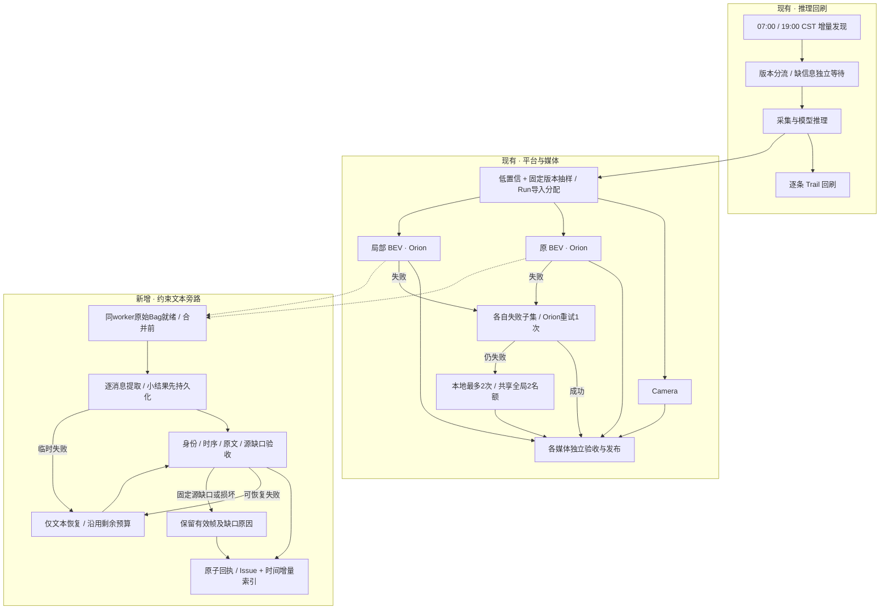
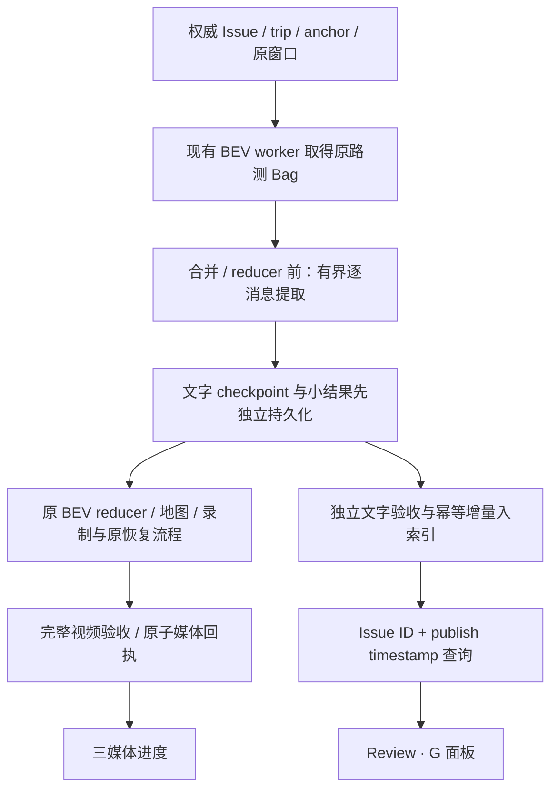

# BEV 原路测约束文本旁路 · Daily 执行契约

状态：2026-11-02。用户已确认紧凑三行 React Flow，并授权部署和19:00验收。实现候选正在进行真实 canary；生产激活结论以私有部署报告及服务器回执为准。

## Daily Cron 任务链路（本次确认范围）

用户确认要查看的是每日任务的 Cron 链路预览。前一版 Daily 文字计数与 Review 面板示例不作为本次链路确认结果。

### 平台实际 React Flow 预览

预览使用真实 Workbench 页面、React Flow/ELK、`daily-cron.css`、共享版本下拉和节点详情抽屉。确认后六个文本节点已接入版本化图模型；原有 Fit View、缩放、全屏和详情交互继续复用。

在现有媒体旁路加入“原始Bag就绪 / 原文导出 / 文字验收 / 增量索引发布 / 仅文本恢复 / 源异常留证”六个节点。原BEV与局部BEV从原始输入就绪事件连入。索引节点读取所选版本真实计数；其余阶段没有对应回执时明确显示需要回执，不能把拓扑当作执行状态。

按用户对横向过宽的反馈，完整图分成上下三行：推理回刷、三媒体、约束文本。中文预览宽度2656→1726，英文2870→1971；缩略图移到右上角。23节点/33边及详情保留原身份和依赖。版本化图组件及 bundle 同时更新，几何结果绑定拓扑，避免切换版本时混用旧几何。

完整链路包含23个节点、33条边；预览可临时聚焦八节点的文本分支。两视图复用原组件的 `unmount/render`、Fit View、缩放、全屏及详情回调；不复制一套图形渲染器。手机继续使用同模型的原阶段卡片。中英文、主题、版本选择与URL由原Workbench组件处理。流程定义数据仅为隔离预览，不代表实时任务状态。

当前按版本增量图的发现入口为07:00 / 19:00 CST，来源为 `buildIncrementalCronGraph`。旧日期任务的09:00入口不适用于当前增量主视图。发现按原周期执行，已有队列持续逐case处理；文字随 BEV worker 执行，不增加一个需要额外等待的新 Cron。

- 图中合并的“各自 Orion 重试”仍是原 BEV 与局部 BEV 各自的失败子集，未合并任务身份或增加预算；任一 BEV 初次/重试/本地 worker 均可在同一个合并前位置产出文字，按 owner 及已存回执去重。
- 视频验收失败继续原有有界恢复流程；Camera 不进入 BEV 的本地恢复分支。三媒体完成数仍取原发布回执交集。
- 文本分支从原始输入就绪事件开始，不等待视频完成。文字已保存、索引失败时只恢复小结果导入；文字失败不重新录制已成功视频。
- 固定源缺口或损坏保留的有效帧可索引，但不能标为完整窗口；完全没有有效帧的失败只登记原因，不计入有帧完成数。
- 图展示依赖与恢复拓扑，不代表生产执行、当前进度或已完成发布。

The current incremental discovery schedule remains07:00/19:00 CST. Planning text branches from a BEV worker's acquired original inputs before reduction, including original/closeup and their existing recovery workers. It has independent validation, receipts and incremental indexing, without waiting for video publication or adding a separate discovery schedule. Recoverable text work uses remaining budgets; known source failures retain their evidence.

## 用户看到的变化

- Daily 的“平台与媒体”保留 Camera、BEV、局部 BEV 三项，在下面增加一行“约束文本”。主数为同批目标中**实际保存了有效规划帧**的 Issue 数；同时列完整窗口、保留源缺口及等待/失败数量。
- Review 沿用当前紧凑的“规划约束 G”面板，按播放器的目标时刻查询。原文默认收起、可展开完整查看；对象 ID 0 保持原值。
- 已有文字直接查索引，视频缓冲或录制失败不影响文字。尚未产出时显示“约束文本正在提取”，避免把采集等待显示成一次很慢的文本查询。
- 三媒体验证继续只计算 Camera ∩ BEV ∩ 局部 BEV 的发布回执交集。文本单独验收，不增加第四个视频入口，不改变三媒体完成数。

The Daily media lane keeps its three media tracks and adds one compact planning-text status row. Review retains the existing G panel and collapsed verbatim text. Text and video publish independently; the three-media intersection keeps its existing meaning.

## 数据与执行设计

### 接入位置

在 `acquire_local_inputs` / 对应 Orion 准备步骤获得原始输入之后、任何 reducer/handler 改写或删除输入之前调用文本导出器。复用当前 worker 已获得的 `/planning/planning_debug` 原始输入和真实时间窗，不使用 reduced Bag 或仿真重新生成的状态。

第一版为一次额外的**本地顺序读取和 protobuf 解码**，随后调用现有 `extract_frame`。它消除重复取源，不宣称已能共享浏览器 worker 内的解码对象。现有接口尚未提供这种共享；在没有验证接口与完整语义前，不加入跨 Python/浏览器 realm 的对象传递优化。

不增加控制端 Bag 上传。Orion 继续按 trip/窗口取得路测源，只回传小型文本结果和必要脱敏验证信息。完整消息必须通过 protobuf 解码及 required-field 检查；局部 wire 投影可读，不能把 malformed 消息变为成功。

文本子进程顺序执行，受当前规划读取监督器和资源门禁管理：单 worker、512MiB 文件输出、4GiB 地址空间、每窗口120秒，沿用自适应拆分与共享锁。保留原 BEV 本地任务进程组预算和两种 BEV 共用的全局两个本地名额，不新增独立本地进程池或提高并发。

导出逐窗口 checkpoint；完成导出后，必须先将小结果持久化到当前任务已使用的受控结果存储，再进入 reducer。仅在 `finally` 上传不足以承受后续 native 崩溃或任务超时。上传小结果失败需保留状态、有限退避和确定身份，不能声明已保存。文本导出或上传异常由旁路捕获并单独留账，视频仍按原步骤继续，其成功不依赖文本发布。

Orion exporter 必须成为有独立源码 SHA 的版本化 worker 包/Tool Bundle；复用冻结 frontend runtime、布局及录制参数。不能通过修改 checkout 假定旧 `bd9f187` 已更新，也不覆盖旧 Release。新包经独立 canary 验收后才能激活。

### 原 BEV 与局部 BEV 去重

文本不依赖视频布局。逻辑身份为 `(Issue, trip, anchor, 原窗口, extractor_version)`，不以 layout SHA 区分两份文字。

控制器以唯一键登记文本 owner；另一种 BEV 引用同一份回执，完全匹配的历史结果直接复用。原生 owner 接替必须同时证明 Job/Task 终态、精确结果对象不存在、索引仍 pending 且无回执，再由现有媒体重试执行 CAS 接替并保存证据。观察失败、未知提交/上传及已有源异常回执保持原 owner；无法证明退出的本地 owner 留账人工对账，不自动重读。

这种复用发生在同一 worker 的原始输入与共享文本产物层面，不表示分布式的两个视频 worker 能共享一个内存对象或已经取消各自的视频取源。

## 文本产物契约

每次导出使用独立的 `planning-text/` 结果目录：

| 产物 | 必需内容 |
| --- | --- |
| `frames.jsonl` | 原生规划消息序列；`publish_ns` 十进制字符串、毫秒查询时间、规划内部时间、原消息 SHA、完整解码状态、当前提取器的 frame 字段与完整原文 |
| `result.json` | Issue/trip/anchor、权威来源与版本、实际窗口及 timing 来源、`source_kind=road`、`simulation_run=false`、extractor/schema/source-manifest SHA、完整/源缺口/失败分类、有效帧数、逐段缺口、t0 匹配结果 |
| `receipt.json` | 上述文件大小/SHA、生产者、Job/Task 或 local attempt 身份、验证器版本与结论；只有全部检查通过才原子发布 |

文字保留原消息频率，不强制400帧，不插值，不用旧值跨洞，不把视频目标帧数当作读到的文字帧数。相同发布时间及原消息 SHA 的重复观察去重；相同身份/纳秒时间但 payload 不同则保存冲突证据并拒绝覆盖。

完整窗口使用现有视频 timing；没有 timing 时只允许已冻结的40秒/t0=20秒窗口，并显式记录来源。不能为了获得更多文本而改写原视频锚点或补造 capture。

沿用 `ares-default-8c071689-v2` 的选中 candidate、solver 与 primitive/search 约束优先级。`ready`、`no_constraint`、`unresolved`、没有源帧及解码失败独立保留。`no_constraint` 是有效的已读规划帧，不是缺数据。

t0/任意查询时间只匹配过去最近消息，最大年龄150ms；保留真实纳秒时间供审计，API 毫秒字段保持当前兼容性。不把未来帧、损坏消息或缺口前的旧约束显示在当前时刻。

### 独立验收

导入前验证身份与窗口、原文/字段类型、消息排序与重复、逐消息 decode 状态、真实帧数、合并后的源覆盖和缺口、t0 因果匹配、SHA 与大小。部分源缺口可发布为 `partial_source`，已有可用帧可读，缺口仍返回“当前时刻无匹配规划帧”。损坏消息不产生成功 frame。

只把已经原子发布的文字回执计入 Daily。至少有一条有效 frame 才计入主数 `with_frames`；`failed` 即使保留了一些有效帧仍需单独显示失败分类，不能靠主数达到目标就结束最终来源审计。

## 增量索引与现有2747成员

当前 `planning_constraints/history.sqlite3` 是已经验证的只读历史快照。它继续使用当前身份/窗口/缺口语义，原文件和回执保持稳定。

新增派生的 `planning_constraints/daily.sqlite3`，由 singleton 导入器消费文字回执。既有 ensure watchdog 在视频控制器持锁或排空时仍可启动导入器；它不创建 Bag、planner、录制或提交任务。每份结果以短事务写入 identity、frames、coverage 和 receipt，提交后才对 HTTP 可见。采用 WAL；请求只读、有限超时和大小，可变 daily 库不能以 `immutable=1` 打开。

- receipt SHA + 逻辑身份组成导入幂等键；重复事件不重复写帧。
- 纳秒发布时间使用 SQLite 64位整数存储，JSON 使用十进制字符串；查询有 `(capture_key, timestamp_ms, publish_ns)` 索引，不全表扫描。
- 调用方已有 trip/anchor 时必须精确匹配；无视频时只能用已验证源记录的身份。多个互相冲突的身份不能按“最近写入”猜选。
- 先复用完全匹配且通过的已存结果；新增副本不能降低原有已验证覆盖，不能用新的 partial 遮掉完整窗口。扩大覆盖或合并不同来源需独立验收，不在请求时拼补。
- 读取有效 daily 结果，其次读取精确匹配的历史结果；只有真正没有已保存结果且没有已知采集状态时，才进入现有受控 lazy 路径。已登记等待项仅返回 `pending/busy`；已知源洞、malformed、损坏索引不自动触发下载或重复取源。
- daily 索引损坏/写入失败独立告警并从已保留的小结果重建；请求不能以此启动 Bag worker，不能回退到其他身份或掩盖已知缺口。

不为每个新 Issue 重建约437MiB历史索引，也不向生产 PostgreSQL 增加业务表。必要的索引整理离线进行，保留原始逐帧结果与导入审计。

## 失败与恢复

| 状况 | 行为 |
| --- | --- |
| 视频和文字均通过 | 分别原子发布；各自更新进度 |
| 视频失败，文字通过 | 文字照常可读；视频沿原恢复流程处理 |
| 视频通过，文字临时失败 | 保留视频，复用同一执行器的 checkpoint 或恢复小结果导入；没有可验证保留输入的计算恢复留账，不为文字重录视频或自动新增取源任务 |
| 文字已导出，索引失败 | 只重试小结果下载/验证/导入，不重新取源 |
| 固定源缺口或 malformed | 保存原失败与可用帧；不盲重读、重投或投影“修复”源消息 |
| 原生任务或提交结果未知 | 只读对账；不能凭 queue.running、旧 PID 或超时重复启动 |

保留既有视频恢复拓扑：Orion 初次 → 失败子集仅重试1次 → 仍失败或验收不通过后本地最多2次，共享全局两个本地名额；历史 attempt3 不重置。文字故障单独记账，不借用“文字失败”重新提交成功的视频。需要计算的文字恢复纳入同一 admission/共享锁及剩余恢复预算，不另起无限队列；小结果下载的瞬态失败仍最多3次退避。

原有完整400帧、≤1ms时序、精确地图、冻结 layout/runtime、完整解码 framemd5、三张 QA/t0海报及媒体原子回执门禁不变。文本不能替代视频验收，视频成功也不能替代文本验收。

## 页面状态与计数

本地浏览器 fixture 的计数均为合成示例。实际进度只使用生产 API 和独立回执。

| 页面状态 | 展示方式 |
| --- | --- |
| 已有文字 | Daily 一行真实有帧数；Review 直接读索引、显示当前主导约束和对象 ID；原文收起 |
| 正在提取 | Daily 显示等待数；Review 显示“约束文本正在提取”，不在点击时重复排队 |
| 当前时刻有源洞 | 保留 `partial_source`；Review 显示无匹配帧并清空旧 ID，可继续查看其他时刻 |
| 视频失败但文字可用 | 视频按原恢复状态展示；G 面板仍显示文字，文字完成数独立 |

实际接入复用现有 `uiText()`/共享国际化、媒体控件、G/Escape/左右键归属、紧凑12px主体/11px辅助文字和移动端覆盖。界面不增加候选路径、刹车索引或调试字段；原文完整保留。新增列表若需要分页，沿用 `.case-pagination` 等共享组件，本设计没有新增列表或下拉。

## 发布与验收顺序

1. 实现版本化 exporter、早期持久化和双 BEV 文本 owner；独立小结果验收与 single-writer 增量索引。
2. 用独立目录验证冷取源及完整40秒窗口，覆盖真实 ready/no_constraint/unresolved/source-gap。已诊断 malformed 仅复用缓存证据作负例，不再读取原源窗口。
3. 原始输入逐消息 SHA/纳秒时间及提取字段与独立 oracle 对照；验证中断恢复、重复回执、身份冲突与索引事务可见性。
4. 对新包做完整 BEV canary：同一原始输入、冻结布局/地图/前端 runtime，验证400帧真实时序、帧内容和全部原发布门禁；现有短片段 smoke 不能替代此项。
5. 展示真实 canary 的文字与 Daily 页面效果、记录时延和资源，再按用户确认的范围部署/激活。先让新增任务随路产出，历史缺项单独列账；已验证历史窗口直接复用。

此前 smoke 已证明3个缓存输入、87条消息的独立 Bag / BEV 合并前入口结果一致，其中86条可提取、1条 malformed 保留失败。它未证明冷取源、完整40秒性能、完整 reducer/视频链或批量吞吐；本设计不把这些未完成项写成已通过。

## 实现参考

- 现有提取：`app/planning_constraint_extract.py`
- 现有保存结果读取：`app/planning_constraint_index.py`、`app/planning_constraints.py`
- 现有全成员索引导入：`scripts/index_planning_constraints.py`
- 本地输入拦截：`scripts/bev_closeup/local_case.py`
- 录制/恢复：`scripts/bev_closeup/orion_controller.py`、`offline_daily.py`、`local_attempt.py`
- 页面：`static/js/daily-cron.js`、`daily-cron-graph.js`、`planning-constraints.js`
- 已有契约：[planning-constraints.md](planning-constraints.md)、[bev-closeup-sidecar.md](bev-closeup-sidecar.md)

## 版本与故障隔离实现

`scripts/planning_text` 对冻结 Ares Tool 做有源码 SHA 的 overlay，仅在原始输入合并前插入 hook；原 Release、runtime/render 文件和布局逐字节保留，控制端不上传 Bag。预览使用独立 tool.preview 文件，不提前认领或发布；显式提交才登记 owner、发布工具与源身份。

结果地址绑定 Job/Task/version/capture。当前原生 CloudFile 的 Job 列表过滤实查未生效，因此不使用它扫描发现；改为物化 Task 列表后读取精确结果地址。查询及下载均受独立进程监督，观察失败不能证明任务退出；小结果下载最多3次退避。上传未知状态只读对账。

每窗完整 protobuf 解码后提取。MemoryError 与提取器/schema异常记为处理失败；消息长度、DecodeError 或 required-field 缺失才记为源解码失败。文本 hook 异常保留独立状态，工具配置失败恢复原媒体配置。

`promote_daily.py` 仅在标准 Dashboard 精确 SHA 部署与同源码真实 canary 通过后，安装不可变个人 sidecar release。它核验两个实际控制器及锁，自然排空 Orion，冻结复核空闲媒体控制器，再替换个人启动入口和原 ensure cron 路径。预算、队列、布局、门槛及其他 cron 保持；不明状态留证对账，不重跑首次 activate_daily 或重复启动。

The implementation uses a source-pinned worker overlay, deterministic Task/version result addresses, independent receipt validation and a singleton incremental importer. Preview has no ownership or publication effects. Native ownership transfers only after proven termination and exact-object absence; unknown/local owners stay held. Deployment and19:00 acceptance require actual receipts, not graph states or native completion alone.
