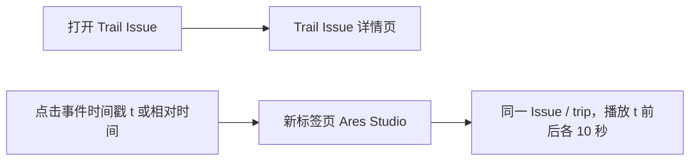
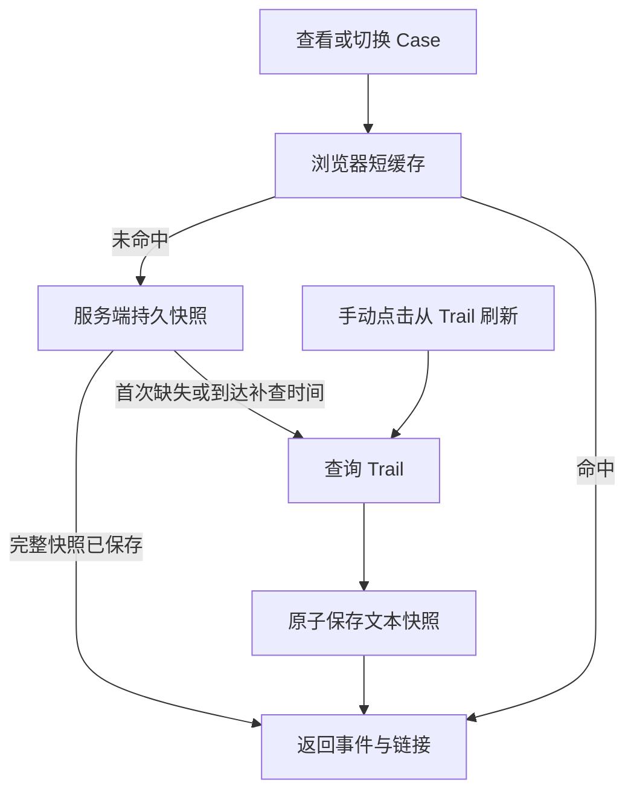

# RA Event 时间戳跳转与 Trail 缓存

## 交互

- Review 和问题标注共用 RA Event 弹窗。
- 点击毫秒时间戳或 `t±…s`，在新标签页打开该事件前后各 10 秒的 Ares Studio。复用 `aresStudioUrl`，保留原 Issue、trip 和固定的播放数据源；原详情页 Ares 入口仍以媒体 t0 为中心。
- 跳转使用已加载的事件元数据，不额外读取 Trail。没有有效时间戳或 trip 时显示普通文本及中英文原因，不构造错误播放地址。
- 事件名、值和原始时间戳保持原值。格式化时间明确为 Asia/Shanghai / UTC+8。表头、搜索、计数、提示、空状态和辅助文本提供中英文；切换语言保留搜索、当前弹窗和焦点。
- 手机沿用原表格容器的局部横向滚动，保留可点击的相对时间，链接触控高度至少 44px。最终响应式规则放在 `mobile.css`。

## 请求与持久化

`GET /api/cases/{issue_id}/trail-metadata` 在本地详情渲染后读取显示用快照。首次缺失时查询 Trail，保存 allowlist 文本；完整快照不自动过期。浏览器缓存过期、刷新页面、服务重启或代码发布后，都可直接复用持久数据，无需再次请求 Trail。

- 目录：实际运行配置的 `DASHBOARD_DATA_DIR/trail_issue_metadata/`。不要假设默认数据目录，也不要放到发布代码树或临时目录。
- 一份小型 JSON 对应 source-root / view / Issue；文件名使用 SHA-256，不接受客户端文件路径。目录0700、文件0600，每份上限128KiB，仅保存现有字段 allowlist、已解析的仿真版本和读取时间；不保存整条 Trail 行、Comment、凭据或模型结果。
- 完整条件：非空事件、trip、有效 RA 起点，且有 RA 结束时间或有效 exit 事件。完整历史事件没有 TTL；缺失或不完整信息按访问最多每300秒补查，空结果/失败等待30秒。没有定时扫描或全量 Trail 轮询。
- 跨进程 `flock` 合并同一 Issue 查询；锁内二次检查，JSON 在同目录 fsync 后原子替换。暖读直接读取已发布快照，不等待正在进行的显式刷新。服务重启后可复用，跨多台服务器需要共享同一持久数据卷。
- 弹窗“从 Trail 刷新 / Refresh from Trail”显式请求 `?refresh=true`，绕过浏览器和旧的进程缓存，更新持久快照；查询中的按钮禁用。失败、错误 Issue 或不完整响应保留已有完整快照；原子写入失败不破坏旧文件。
- 服务端按原始 ID 重建链接，保留主线已有的已验证本地屏蔽 RA 仿真映射。当前解析出的仿真版本随显示快照保存，显式刷新可重新查询版本。
- 只读返回 `metadata_source`、`metadata_fetched_at`、`refresh_status`；不向浏览器暴露本地文件路径。读取时间超过300秒后，旧快照中的 `dashboard_should_exclude` 不作为当前首次 Review 的默认值；Trail 写预览及回读继续使用原有独立实时读取，不消费该快照。
- 浏览器仍有最多200条、成功5分钟/失败30秒的内存缓存，减少 Workbench HTTP。其过期只会重新读取服务端本地快照。快速切换保留350ms停留检查，旧消费者和旧弹窗结果不能更新新 Case。
- `DASHBOARD_TRAIL_DETAIL_METADATA_ENABLED=false` 保持关闭远程查询的语义。旧 `DASHBOARD_TRAIL_DETAIL_METADATA_CACHE_SECONDS` 只属于原内存读取器；持久化接口不再受它控制。普通访问已保存的完整事件不会按5分钟回源。

无需修改主数据库 schema 或安装依赖。持久快照应随应用数据卷保留；它是可重建的显示缓存，不能用应用 Git 回滚清空。当前没有对历史 Case 做批量预取/回填，首次查看未保存的 Case 仍需要一次查询。

## 紧凑链接样式修正（2026-11-04）

时间链接沿用原单元格的颜色、字号和自然行高，默认不显示下划线，悬停或键盘聚焦时显示下划线，保留聚焦轮廓。移除桌面链接的26px最小高度后，实测单行从45px恢复到35px，与同表纯文字行一致。手机仍保留44px点击高度，第三、第四列取消额外上下padding，长内容按原有规则换行，表格继续局部横向滚动。

本次只改共享样式和最终响应式覆盖，前端缓存升为cache752；事件链接、Trail持久化、刷新及业务逻辑保持原契约。本地52项相关测试及6subtests通过；Chromium151的320/390/1440px ×zh/en ×dark/light ×Review/问题标注24组合通过，另检查默认/悬停/键盘聚焦、行高与纯文字对比、4刷新场景及原±10秒链接。截图为合成数据的本地浏览器检查，发布结果另行记录。

## 链接示意



| 入口 | 目标 |
| --- | --- |
| 打开 Trail Issue | `https://voyager.intra.xiaojukeji.com/static/management/#/issue/{issue_id}?view_id=2410` |
| 事件时间戳 / 相对时间 | `https://voyager.intra.xiaojukeji.com/static/ares-studio/?ds=voy-ws-car&ds.issue_id={issue_id}&ds.trip_id={trip_id}&ds.start={t-10000}&ds.end={t+10000}&entry_last_page=%2Fissue%2F{issue_id}` |

这里的 `t` 是该行事件的毫秒时间戳；花括号仅表示参数示意。Trail 入口打开原 Issue；事件链接的时间窗口在 Ares URL 中表达。点击已加载的事件不产生 Trail 查询。



## 验证与发布

已于 **2026-11-03 23:31:22 CST** 上线 `3d8719233d893bc58f957f203bd85967b00d022a` / `manual-triage-750`，普通 master 发布；未增加依赖或数据库迁移。

- 统一发布回执：`/volume/home/workspace/ra_triage_dashboard_deploy/releases/20261103T152750Z-3d8719233d89/result.json`。完整云端测试 **1298 passed, 8 skipped in 193.04s**，隔离 SQLite 灰度及精确 SHA 的生产 PostgreSQL、持久化、整体健康、身份和原写入策略检查全部通过。
- 首次准备 `d96932e9` 在新增的两项 API 测试因云端缺少可选 httpx 而失败，其余1296项通过，未切换生产。修正为项目既有的无依赖 ASGI HTTP 请求模式后，以 `3d871923` 重新执行全部门禁通过；没有跳过这两项测试或修改共享环境。
- 生产读回 **2026-11-03T15:32:03.914771+00:00**：shell/cache750及5项静态资源与 Git 原字节一致。`cn35759965` 首次读取8条事件，保存1097字节、0600完整快照；第二次 `metadata_source=snapshot`，读取时间、文件内容及mtime均不变，`retry_after=0`。服务端使用实际持久数据目录。
- 浏览器自动化的新标签页、导航和DOM验收多次超时；本次未完成带SSO的线上事件点击和Ares实际播放验收。以下浏览器结果为合成数据的本地检查。

- 基于最新主线的本地89项相关测试、22subtests及实际 JS 缓存测试通过。
- 持久化覆盖：新实例/新HTTP客户端、跨一年读取无回源、4独立进程只查询一次、显式刷新、失败/不完整保留、原子写失败、缺失重试、allowlist/权限/源隔离/损坏文件/符号链接拒绝和旧排除标记保护。
- Chromium151.0.7922.34，320/390/1440px ×zh/en ×dark/light ×Review/问题标注，共24组合；另有4刷新检查：搜索保留、忙时去重、失败保留和语言切换、旧弹窗结果拒绝。目标Ares页面由测试拦截；普通弹窗操作新增Trail元数据请求0，明确点击刷新3次。
- Case/API为合成数据，未做业务写入。这些是桌面Chromium视口测试，不是真机/iOS/Safari验收；线上验收单独记录。
- 本地证据：`reports/ra_event_trail_cache_20261103/`。生产证据见该目录的 `production-postflight.json`；本地24组合及刷新检查见 `release-responsive-results.json`。

重跑浏览器验收需已有 Playwright：

```sh
NODE_PATH=<包含-playwright-的-node_modules> node ra_triage_dashboard/tests/ra_event_navigation_browser.cjs
```
