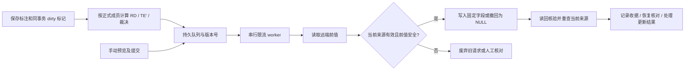

# 1106 起 Manual RD / TE′ 标注与上传

2026-11-13 12:17:15 CST 已发布 `/manual` 运行版本 `bc7c95b24bca9a22e64e1e0d62b6e936a7557a9f`、cache797、schema061，随后生产只读核验通过。**真实 Trail 自动及手动回刷已启用且本次保留**，1106 当前 27 个目标均已启用同步资格。抽样集 7 个 case / 14 份任务，低置信集 20 个 case / 20 份任务；成员交集与按冻结 seed 检查的错分数均为 0。字段能力、NULL 清空、稀疏空值及平台六级优先级已实测；外部数易报表单独记录为未验证，不作为 Trail 开启条件。

正式版本已整合 `66710f8ac109e565ed659884d5a0b2882bd54db8`，保留最新视频播放、冷启动及共享标签提示修复。本地功能分支为 `codex/manual-role-publication-20261112`。用户已在本次会话明确允许公开推送，并明确批准停写、备份恢复校验、schema061、旧任务迁移及指定 TE 标注权限配置；完整发布证据见文末正式部署记录。

长期规则及两张说明流程图已归档到看板 skill 的 `references/role-label-publication.md`；本文件记录实现、验收及上线步骤，运行状态最终以发布回执和实时健康检查为准。

## 规则速查

| 情况 | 任务进度 | 正式结果与 Trail 行为 |
|---|---|---|
| 只分给一位 RD，他已提交 | 该人的联合复核完成后计完成 | RD 可发布 |
| 分给两位 RD，只提交一人 | 1/2 | RD 等待另一位；已有平台发布结果失效时进入撤回 |
| 两位必需 RD 均提交且一致 | 2/2 | RD 可发布 |
| 两位必需 RD 均提交但不同 | 可为 2/2 | RD 冲突，不采用“后提交覆盖”或多数票；撤回平台拥有的旧结果 |
| RD 与 TE′ 不同 | 分别计算个人进度 | 两条通道分别发布，可另行裁决 |
| 未分配的 RD/TE 发表相同意见 | 不增加负责人进度 | 保存补充意见，不重复上传 |
| 未分配的 RD/TE 发表不同意见 | 不改变正式任务进度 | 保存异议，正式结果与已有 Trail 值不变 |
| 管理员将异议者正式加入任务 | 按新成员配置重新计算 | 该人的当前有效票参与本角色共识；待齐/冲突时撤回旧结果 |
| 正式负责人采纳反馈并改标 | 保留旧版本及新版本 | 重新计算本角色；失效的裁决也撤回 |
| 正式负责人撤回标签 | 原提交记录保留 | 当前角色等待有效标签，撤回已有平台结果 |
| 用户 RD/TE 身份调整 | 不重写历史提交/分配身份 | 新提交按当时身份记录，角色不符的票不补齐原角色 |
| 管理员普通标注 | 按普通标注规则 | 不自动成为裁决 |
| 显式最终裁决 | 原始票保留 | 仅发布裁决通道；绑定的正式来源变化后失效 |
| 来源任务停用、目标移出、标注范围停用 | 保留历史 | 不再发布有效结论；撤回拥有的旧结果 |
| 远端已有不同值或被外部修改 | 与任务进度无关 | 转人工核对，不覆盖外部数据 |
| 远端刚好等于期望值 | 与任务进度无关 | 记录“一致”；不据此取得所有权，之后也不能擅自清空 |

“任务完成”仍要求该必需成员完成模型 Review 和 Case 标签确认，不等同于填写任意一项。两人任务只标一个人，整项任务不算完成，但已满足条件的独立 RD/TE 通道可以先发布。

低置信任务本次仅设一位必需 RD。可选 TE 不自动分配；当前手动加入任务的成员都是正式必需成员。若只希望补充意见而不影响交付，应使用任务外标注，不能把新增必需成员当成“可选”。

## 分配和字段

一个版本保留一个 dataset / prediction Run，生成两个可追加任务：

- 抽样集：`jasperchen` / `liangxianghui` 每条选一位 RD，`yupuxue` / `zhangxuzhao` 每条选一位 TE。各组累计 1:1，奇数相差最多一条；使用持久化 seed 独立随机，并平衡四种搭配，避免固定搭档。
- 低置信集：排除抽样交集，每条分一位 RD，累计平衡。增量只追加，历史成员不重排；迁移优先保留历史负责人，后续新增逐步平衡。

从 release family `20261106` 起应用；旧版本分配规则保留。业务身份 RD/TE 与 writer/admin 权限独立，默认 TE 为 `yupuxue`、`zhangxuzhao`、`lishizhong`、`zhangyang`，其余已有用户为 RD。身份编辑有审计，提交和分配均保留身份快照。

上传页面也遵循这个版本边界：选择 1030 或更早数据集时，保留原有“RD 标注上传 / TE 标注修正”；只选择 1106 起版本时显示“RD 标注 / TE′ 标注 / 裁决标注”。旧版 TE 修正与 TE′ 对应不同字段，不能为了统一页面把历史数据切到新通道。验收入口应使用 `rd-results?baselines=version-20261106`。

cache797 修正了默认版本任务卡仍写“版本联合复核 / 低置信＋抽样 · 单人负责 · 无交叉”的遗漏。判错复核任务列表及 Case 联合任务卡现在复用同一名称与分配说明，分别显示“1106 · 抽样集 / RD＋TE 交叉标注”和“1106 · 低置信集 / 不含抽样 · RD 单人标注”；详情采用同一说明。仅调整文案，复用原 DOM、样式、进度、负责人及任务链接，不重分配、不迁移、不写 Trail。回归覆盖两条真实列表渲染入口及旧版本卡片；本机 78 项定向检查通过，合成 DB 的无头 Chrome 在 320/390/833/1440px、中英文和深浅主题代表组合中验证任务卡、负责人、进度、任务链接、运行时语言切换、1030/1106 切换与三通道字段映射，无页面横向溢出。视口检查不代表真机或生产 SSO 标注提交验收。

| 上传页签 | 字段 | 触发 |
|---|---|---|
| RD 标注 | `ra_rd_review_result` | 正式 RD 共识有效 |
| TE′ 标注 | `ra_review_result_sampling` | 正式 TE 共识有效 |
| 裁决标注 | `ra_review_result_arbitrated` | 显式裁决且来源仍有效 |

正确触发写为 Trail 枚举 `成功`，其余为 `误触发` / `无需协助`。既有 TE 修正入口的 `ra_review_result_new` 不等同于 TE′。

业务指标优先级为：

`ra_review_result_arbitrated > ra_review_result_sampling > ra_review_result_new > ra_rd_review_result > ra_stuck_auto_result > ra_result`

代码提供对已观测六个字段的上述选择规则；缺失字段保留 unknown，只有真正 NULL 才向后回退，空字符串不当作 NULL。**外部业务指标消费者的实际读取与刷新尚未验证**；不能把上传成功等同于指标已刷新。Workbench 的不可变评测 GT 不随上传改变。

## 异步处理



保存 HTTP 请求不等待 Trail。worker 每轮约 10 秒，合并短时间内的变化，单批最多 20 条。自动/手动共用一个发布器、文件锁及 PostgreSQL advisory lock；真实读写每个 HTTP 请求间隔至少 1 秒，包括 SDK 内部分页。这个限额覆盖新的人工作业，不代表 Cron、外部作者等所有客户端的总 QPS。

写前持久化 intent；写入超时也先读回，不盲目重发。进程重启恢复未确认 intent，指数退避，恢复读取最多 5 次后要求人工核对。失败重试有上限；手动核对使用同一队列。前值不符时不覆盖，远端恰好相同也不取得所有权。

来源变更会取消过时任务；远端 I/O 期间出现新提交会在读回时重新计算，并安排补偿更新。Trail API 无 CAS，仍存在外部作者在读取与写入之间修改的竞争窗口；内部串行锁不能消除此风险，后续多方 writer 协调属于上线验收的一部分。

上传页支持三通道、当前正式票/异议、同步状态、手动预览和历史。预览冻结 generation / fingerprint，15 分钟过期，提交时重新验证。列表 GET 和预览不实时请求 Trail。分页、下拉、中英文和移动端沿用现有组件；版本图库按 case 去重，展示各负责人进度并支持 TE 筛选。

## 与 Cron 的负载比较

前序只读观测：2026-11-05 至 11-11 CST，Cron 固定版本 `87210975464bc1ceada33c9b7e0b6c5b866f4bf5` 成功发布 1,203 条，日均约 172、最高 455。正常发布包含写前读、写入、读回；抽样另有阶段。**这不是实际 HTTP/QPS/延迟测量，也不是容量承诺。**

设一天三个通道的有效值变化数为 `H_rd / H_te / H_arbitrated`，总和为 H。忽略重试、撤回和查询分页时：

- 每次只到一条：约 `3 × H` 次请求。
- 每通道理想满批：约 `3 × Σ ceil(H_lane / 20)` 次请求；10 秒合并窗口内未必能凑满。
- 同标签重复 Enter、只改说明、相同补充意见不会新增写入。冲突撤回、重新裁决、重试会增加请求。

以 H=172/455 仅作同量级示例，逐条约 516/1,365 次请求/日；均摊约 0.006/0.016 QPS。新增 TE 和裁决会增大 H，日均不能代表峰值。新 worker 的人工作业峰值被限制为 1 HTTP/s，代价是积压时延长同步等待。

上线灰度需记录真实请求数、批量填充、队列最老年龄、保存至确认耗时、远端延迟、失败率、重试/撤回量；与同一时段 Cron 实测对比后再调速。本次没有压测真实 Trail。

## 历史迁移和启用

新增 SQLite schema 与 PostgreSQL migration `061_human_label_publication.sql`，复用现有 `issue_label_decisions`，没有第二套裁决库。生产原始任务含已提交记录，不能按空库直接重分配。

1. 在获准的环境获取逻辑备份并做恢复演练，保持所有真实 writer 关闭。先在恢复库安装 migration 061，检查旧任务、引用、负责人、提交和进度数量。统一部署器仅放行该文件的精确审阅摘要，仍需显式 additive migration 模式及备份验证；没有放宽对任意触发器/函数的限制。
2. 用 `scripts/migrate_human_labels.py --action plan` 生成只读 inventory。被阻止的范围、缺失身份依据、重复/不明来源需先处理。plan 不初始化 schema。
3. 审阅 inventory，带备份文件执行 apply。报告 fingerprint 不匹配会拒绝；apply 在单事务内创建两个任务、保留旧 RD 负责人、添加抽样 TE、冻结原引用、迁移可变 head/进度/评论，并保存含原记录的不可变审计收据。
4. 标签/模型 revision 和历史提交原文不改；旧任务保留为 superseded。带 Issue 的旧链接转到新任务，旧提交与迁移后旧链接的新提交均支持幂等重放。没有 Issue 的旧任务入口保留归档身份，不猜测应该去两个新任务中的哪一个。
5. 历史 scope 的 `publication_armed=0`。即使打开总开关，也不会自动回刷这批历史；apply 不访问 Trail。缺失历史角色证据必须显式指定分类，不能用当前目录反推历史。
6. 用户验证通过，且三个字段的枚举、真正 NULL 清空、稀疏空值语义和平台优先级回退均有实测证据后，使用私有能力收据执行独立 arm，再按批准范围开启总开关。历史启用会允许这一范围进入队列，必须审阅范围后执行；外部数易报表刷新不属于此门禁。

恢复库上的示例（`$ROLE_DB_URL_FILE` 是 0600 文件路径，不是连接字符串）：

```bash
python -m ra_triage_dashboard.scripts.migrate_human_labels \
  --database-url-file "$ROLE_DB_URL_FILE" --dataset release-20261106-odd2 \
  --action plan --output "$ROLE_RECEIPTS/plan.json"

python -m ra_triage_dashboard.scripts.migrate_human_labels \
  --database-url-file "$ROLE_DB_URL_FILE" --dataset release-20261106-odd2 \
  --action apply --reviewed-report "$ROLE_RECEIPTS/plan.json" \
  --backup "$ROLE_BACKUP" --actor jasperchen --historical-role rd \
  --output "$ROLE_RECEIPTS/applied.json"

# 仅在用户验证及真实字段能力验收通过、明确批准启用后执行：
python -m ra_triage_dashboard.scripts.migrate_human_labels \
  --database-url-file "$ROLE_DB_URL_FILE" --dataset release-20261106-odd2 \
  --action arm --reviewed-report "$ROLE_RECEIPTS/applied.json" \
  --capabilities "$ROLE_CAPABILITIES_FILE" --actor jasperchen \
  --output "$ROLE_RECEIPTS/armed.json"
```

`--historical-role rd` 仅适用于已核实的原来纯 RD 批次，不是任意历史数据的默认推断。CLI 对备份文件计算 SHA256；数据库 URL 不进 argv，输出收据以 0600 创建且不覆盖已有文件。

真实写入需要同时满足 `DASHBOARD_HUMAN_LABEL_WRITE_ENABLED=true` 和 `DASHBOARD_HUMAN_LABEL_CAPABILITIES_FILE` 的私有、非符号链接能力收据。示例 [human-publication-capabilities.json.example](human-publication-capabilities.json.example) 明确未验收，不能直接用于启用；需记录具体受控 Issue、时间、枚举写入/NULL清空/读回及平台六级优先级回退证据。`priority` 必须与固定字段顺序完全一致且 `priority_verified=true`；`absent_means_null` 必须单独用空值筛选和非空对照实测，不能因字段缺失而默认开启。按用户 2026-11-13 明确的范围，Trail 回刷启用不依赖数易登录态或数易报表刷新；`external_metrics_verified` 独立保留，不能因开启回刷而改成 true。

回滚先关闭人工作业开关并停止 worker，保留 intent/收据后核对未确认写入。代码回退不得丢弃新增 schema 和审计；已迁移数据不能直接用旧版本重新分配。需要恢复备份时应先核对备份后的新增业务记录，不能覆盖丢失它们。远端结果恢复必须经过前值核对和独立批准。

## 验收记录与用户验证入口

本机 Python 3.10 + SQLite；另用本机隔离 PostgreSQL 14.11 Unix socket，合成数据库、模拟 Trail。PostgreSQL 专项 21 项通过，包含真实 migration 061、迁移回滚及数据库后端断言；不会把 SQLite 结果算成 PostgreSQL 结果。

完整回归：**1,412 passed、234 subtests passed、16 skipped、7 warnings**（154.37 秒）。跳过项不算通过，警告为依赖弃用提示。部署器专项 **42 passed、9 subtests passed**，包含所有 writer 灰度关闭、061 精确摘要与显式迁移模式。

| 验收范围 | 实际覆盖 | 结果 |
|---|---|---|
| 分配与追加 | RD/TE 各组平衡、四种搭配、冻结抽样、重复包及新增包、旧分配保留、case 去重 | SQLite / PostgreSQL 合成数据库 |
| 任务与同角色共识 | 单人、双人待齐/一致/冲突、两角色独立、自己的过期草稿拒绝 | 通过 |
| 任务外意见 | 单独补充不能完成负责人任务、不同意见不覆盖、正式接纳后重算与撤回 | 通过 |
| 身份与裁决 | 角色历史快照、明确裁决、正式来源变化失效、补充意见不误伤裁决 | 通过 |
| 失效与恢复 | 标签撤回、来源屏蔽、scope 停用、事务失败不留半次提交 | 通过 |
| 发布器 | 禁用无远端 I/O、共享锁、逐 HTTP 限流、批量与固定字段、超时读回、重启恢复、重试上限、在途新版本补偿 | 模拟 Trail 通过 |
| 外部值与 NULL | 外部变更拒绝覆盖、相同值不取得所有权、三通道 NULL 回退和能力收据门禁 | 本地规则通过；真实接口待验证 |
| 手动与鉴权 | 与自动同队列、预览过期/来源校验/幂等、writer/admin 门禁、请求标记、分页校验、旧 RD 接口不能绕过 | 通过 |
| 历史迁移 | inventory 漂移拒绝、收据失败原子回滚、原负责人（含新名单外 RD）/版本/引用/进度保留、旧链接双向幂等、历史单独启用 | SQLite / PostgreSQL 通过 |
| 上传页面 | 1440 中文深色/英文浅色、390 中文浅色/英文深色、320 英文浅色；三页签、选择清理、分页 URL、语言草稿、下拉键盘/Escape、空/失败、历史、无页面横向溢出 | 浏览器 5 组通过 |
| 用户身份表单 | 320px、共享下拉、语言切换保留未保存身份选择、无横向溢出 | 浏览器 1 组通过，未执行目录保存 |
| 版本图库 | 1440/390/320px、TE 负责人筛选、双人进度、第一页修改条数、跳页/刷新/语言保留、空结果 | 浏览器 3 组通过 |
| Review 新组件 | 1440/390/320px 角色结论/异议说明，中英文切换保留草稿，手机说明按钮至少 44px | 浏览器 3 组通过，组件级范围 |
| 静态检查 | 修改的 36 个 Python / 13 个 JS 文件、diff 空白检查、秘密扫描、skill 校验、迁移 CLI help | 通过；扫描中的 `task-*` 子串已排除误报 |

浏览器共 **12 组、无 JavaScript 错误**。报告与截图位于本机 `/private/tmp/manual-role-acceptance/`，完整回归日志 `/private/tmp/role-full-final.log`，PostgreSQL 专项日志 `/private/tmp/role-pg-result.log`。最终验收截图已人工查看桌面上传页、320px 上传页/双负责人卡片/Review 说明及用户身份表单。

2026-11-12 用户验证后的排版修正（本地候选 cache792）：沿用原标注上传页的字体、页签、概览统计、筛选栏、选中操作、标签和表格样式。三通道仅扩展原有页签；长说明默认折叠，行内不重复展示“已完成 + 标签”和逐条时间。任务外异议在记录入口标出，展开后保留具体意见、异常原因、核对时间和上传历史。取消本页独立的固定列宽与手机筛选布局，复用共享下拉和响应式规则；后续界面改动继续遵守此约定。

该次修正的前端定向检查 **63 passed、6 subtests passed**；既有 **12 组浏览器检查**重新通过，另验证三通道 × 1440/390/320px 共 **9 组**概览筛选、选择清理、说明展开、语言切换与轮询保持状态，均无 JavaScript 错误。报告和截图在 `/private/tmp/manual-role-layout-acceptance/`。本次仅改展示层，未重跑此前的全量后端回归；这些结果仍是本机合成预览验收。

后续正式部署已完成生产备份恢复与数据迁移，并按下文 2026-11-13 记录完成真实 Trail 枚举/NULL、稀疏字段和平台优先级验证及回刷启用。外部数易指标消费者、生产 SSO/完整媒体 Review 提交链路、真实手机软键盘/触摸仍独立记录为**未验证**；不能把 Trail 开启或本机组件验收说成这些链路已经验收。

主要可复跑入口：

```bash
python -m pytest ra_triage_dashboard/tests -q --tb=short
python -m ra_triage_dashboard.tests.preview_human_publications --port 50269
python -m ra_triage_dashboard.tests.human_publications_browser
python -m ra_triage_dashboard.scripts.migrate_human_labels --help
```

预览使用 60 条合成 case，真实 API / 数据库 / 页面组件；外部写入关闭。可检查：

- `http://127.0.0.1:50269/rd-results?baselines=version-20261106`：三通道、正式结果/异议/同步状态、预览、历史、筛选分页。
- `http://127.0.0.1:50269/version-datasets?dataset=release-20261106-odd2`：双负责人、独立进度、TE 负责人筛选、每页条数和跳页。
- `http://127.0.0.1:50269/rd-results?baselines=version-20261106&preview=users`：业务身份控件及语言切换草稿保留；这是表单展示预览，不提供目录保存。

浏览器验收使用 macOS 无头 Chrome 的调整视口，不能称为真机或移动模拟器验收。Review 状态/异议说明为组件验收，不代替真实 SSO、媒体与完整 Review 提交链路的灰度验证。

## 2026-11-12 部署准备记录

应用候选 `a5c414163638c9c62e8c7ef1b794106be12beec5` 已重放到线上基线 `0f32502749e0dc5a4376f6ae3536d617490f7562`，冲突仅涉及静态资源版本号，统一为 cache794。最新视频播放、冷启动和 Range 下载修复均保留。21:28 CST 只读核查生产仍是该基线、PostgreSQL 健康、云端工作区干净，本次功能尚未部署。

整合后本机完整回归 **1,416 passed、234 subtests passed、16 skipped、7 warnings，180.07 秒**；隔离 PostgreSQL 14.11 专项 **21 passed**；合成预览 **12 组浏览器检查通过，JavaScript 错误为 0**。36 个 Python、12 个 JavaScript 修改文件的语法检查及 diff 空白检查通过。061 的精确审阅摘要仍为 `646f328dd24db468f33e2221d5e7de993a4945d40de01e1260c2fef70e4460bd`。

本机证据目录 `/private/tmp/manual-role-deployment-prep/`：`full-local.log`、`postgresql.log`、`browser.log` 和 `browser/report.json`。本记录之后的文档提交不改变已测应用代码；后续统一云端发布器仍须按最终推送 SHA 执行完整测试与隔离灰度。

只读生产数据集汇总：当前 1106 起仅 `release-20261106-odd2`，总入库 202、当前目标 2（抽样 2、低置信独占 0）、revision 7。此为当时观测，不作为最终迁移清单；切换时重新生成 fingerprint，保留原负责人、提交和引用。既有任务未完成审计迁移前，增量导入会失败关闭，不能绕过门禁创建另一套分配。

下一步使用统一入口，以最终推送 SHA 执行 `release_dashboard.py --sha <SHA> --prepare --allow-additive-migrations`。prepare 只运行云端完整测试和隔离灰度；生产切换阶段另做停止写入后的新鲜备份、恢复与计数核验、061 安装及历史任务迁移。代码回退与数据迁移回退分别处理，不能让旧分配逻辑重新处理已迁移任务。

当前远端 `git@github.com:Jh271441/ra_tools.git` 经仓库元数据核实为公开仓库。用户随后明确允许将本次源码推送该仓库，继续沿用统一发布入口。云端灰度、生产备份恢复与数据迁移、SSO 完整链路、真实 Trail 字段/NULL/指标回退均未在本地准备阶段完成。初次发布保持 `DASHBOARD_HUMAN_LABEL_WRITE_ENABLED=false`，不自动启用历史回刷。

## 2026-11-12 正式部署与生产验收

统一发布收据 `/volume/home/workspace/ra_triage_dashboard_deploy/releases/20261112T135002Z-4be1726f10fb/result.json`：`status=success`，22:25:18 CST 切换至 `4be1726f10fbbbc2122718a4872841aaa3ac0b1b`。精确 SHA 云端 **1,423 passed、9 skipped，229.43 秒**，隔离 SQLite 灰度通过。首次准备因可选 `httpx` 缺失未通过；改用项目既有 ASGI 客户端，原鉴权/分页/关闭写入断言完整保留，没有变更共享运行依赖。

切换前另外用一致性导出快照恢复并核对 **104 张表**，在恢复库完成 061、指定人员配置和两条旧任务迁移。正式切换由发布器停写后生成新鲜逻辑备份，完成 checksum、恢复与全表计数核验，安装 schema060→061 后启动应用。22:28:36 CST 完成生产任务迁移，22:30:56 CST 后端复核健康。

本次迁移范围仍为两条抽样目标，原 RD 负责人、原始 Case/模型标注版本、提交、冻结引用和旧负责人记录均逐项摘要核对不变。旧任务保留为 superseded，带 Issue 的旧链接可解析到新的抽样联合任务。RD `jasperchen` / `liangxianghui` 各一条，TE `yupuxue` / `zhangxuzhao` 各一条。当前低置信独占目标为零，其独立任务会在首条目标追加时创建。

两位新 TE 登记为 `writer`、`intent_permission=annotate`；其他已登记人员的访问权限保持原值。四位指定 TE 的业务身份已登记，`zhangyang` 仅初始化业务身份，没有额外授予访问权限。三条发布通道各有两条本地状态记录；历史 scope 均 `publication_armed=0`，真实远端尝试为零，`human_label_write_enabled=false`。

部署后验证 PostgreSQL 持久化/schema61/整体健康、启动 JS/CSS bundle 及七个入口/模块字节、未验证直连身份对受保护新接口的 403 拒绝、旧链接与人员权限。9 个静态资源与发布 Git 字节相同；既有原生视频与共享标签提示模块保留。以上是生产后端/资源验收，没有宣称真实 SSO 页面点击、手机或真实 Trail 写入验收。

迁移与 postflight 私有回执根目录为 `/volume/home/workspace/ra_triage_dashboard_deploy/operations/manual-role-publication-20261112/20261112T135002Z-4be1726f10fb/production/`。其中 `verified-backup/` 永久保留独立副本，不受滚动备份/发布清理影响；SHA-256 为 `83319da1a75417c3d6e56f2e61b5f691a005e80b9d307b6bbd3c0034be7c753d`。不得直接用切换前备份覆盖后续新标注；数据迁移后优先按审计记录向前修复。

用户验收入口：

- `https://auto-triage.intra.xiaojukeji.com/manual/rd-results?baselines=version-20261106`：三类页签、两条真实目标与本地同步状态、详情/异议/历史；真实写入不可提交。
- `https://auto-triage.intra.xiaojukeji.com/manual/version-datasets?dataset=release-20261106-odd2`：原 RD 进度、TE 负责人及独立进度；查看原任务旧链接仍能定位同一 Issue。

2026-11-13 后续验收修正：生产 SDK 的查询配置仍使用已知 HTTP 地址，限流适配器现先严格识别这两个已知协议地址，再统一规范为 HTTPS，其他主机、路径和附加查询参数仍拒绝；HTTP/HTTPS 两种配置均覆盖逐分页限流回归。用户进一步指定上传说明恢复原版，现直接复用 `rdOverviewInfoMarkup` 的“上传接口 / 目标字段”布局，不再使用新增的 `hpInfo` 折叠说明和长文案；字段仍随 RD/TE′/裁决页签切换。前端定向 63 项、12 组本机合成浏览器检查通过，候选 cache796；实际部署和回刷启用另以运行回执为准。

## 2026-11-13 Trail 受控验收与启用

用户明确要求启用，并指定一个 Case 允许对 RD/TE′/裁决三个字段进行临时写入、清空、读回和还原。三字段各自的 `成功` / `误触发` / `无需协助` 和真正 JSON NULL 均通过真实 API 验证；首轮共 50 次 HTTP，最短请求间隔 1.0001 秒。指定字段恢复为空，原 TE、模型输出/说明、原始结果和合并字段均保持原值。本次没有创建用户标注或改写本地不可变 GT。

另以 Trail `empty` 筛选核对显式 NULL 和原本未设置的字段，并以非空 TE 字段作为阴性对照。随后对同一受控 Case 的真实读回验证裁决 > TE′ > TE > RD 的相对优先级；RD > Auto > TO 使用真实读回的本地副本验证，未为了测试而修改受保护 TE、Auto 或 TO。两轮均恢复原字段。能力收据同时记录 `priority_verified=true`、稀疏空值语义和各字段枚举/清空证据；`external_metrics_verified=false`，没有伪造数易验收结果。

用户纠正了范围：启用 Trail 回刷不需要数易登录态。现在开启门禁只验证 Trail 字段语义和平台结果优先级；数易登录、SQL 及报表刷新是独立验收，不影响本次开关。之前对数易依赖的尝试不代表数易数据已被读取或报表已刷新。

原版说明布局与 HTTPS 修复先发布为 `373c54a3cddeb5c6519b883ad582e76dd40c4c66`，随后门禁修正发布为 `aaaff60dfbb7ad2c78c9c6557fa7b719333db4fe`，cache796 不变。两次精确 SHA 云端均 **1,424 passed、9 skipped**，隔离灰度和生产健康通过；没有新增 schema 或修改其他业务权限。

02:35:45 CST 开启 `DASHBOARD_HUMAN_LABEL_WRITE_ENABLED=true`，使用私有合格能力文件，并通过既有审计迁移 CLI 为 `release-20261106-odd2` 两条 scope 执行独立 arm。配置启用流程复用版本化部署器的发布锁、优雅停启、健康检查和失败回退，保留所有其他写入/身份策略；当前自动与手动队列门禁均开启。既有两条目标仍是 RD/TE 待标、无裁决，尚无正式结论可以回刷，不能把开关开启等同于已上传标签。

私有启用记录：`/volume/home/workspace/ra_triage_dashboard_deploy/operations/manual-role-activation-20261113/enable-8f7fc7357bec4fd9a5d08d18b1b70239/result.json`，同目录包含 `postflight.json`、`armed.json`、0600 的运行配置和原配置。能力与请求/读回证据保存在同一 operation 根目录的 `fields-*` 和 `priority-*`；不提交源仓库。未来部署应从实际运行进程捕获当前 human writer=true 和私有能力文件路径；不得用之前 writer=false 的发布配置覆盖本次启用。


## 2026-11-13 双任务卡片名称修正正式发布

精确版本 `490856f16abf6f415e6b524799d43107152a9565` 于 11:48:34 CST 正式上线，cache797。统一部署器完整云端 **1424 passed、9 skipped / 232.74 秒**，隔离 SQLite 灰度和正式 PostgreSQL/健康/写入策略检查通过。首个候选在切换前被一项仍引用旧缓存号的基础路径测试拦截，生产未变；同步两处断言后完整重跑通过，没有删减测试或跳过检查。发布回执：`/volume/home/workspace/ra_triage_dashboard_deploy/releases/20261113T034422Z-490856f16abf/result.json`。

发布后只读核验运行 SHA、cache797 HTML、实际下发的 JS/CSS bundle 与任务卡模块字节均一致。human writer=true，原合格能力文件路径与所有其他写入策略保留；没有迁移、权限变更、重分配或验收写入。1106 抽样/低置信两个正式任务分别为 7/20 个 case，14/20 份任务，成员交集和错分均为 0，27 条 scope 全部 armed。任务卡和说明采用原布局；1030 仍显示原 RD 上传/TE 修正，1106 显示 RD/TE′/裁决三项。

本地共 82 项定向测试、6 个 subtest 通过，5 组无头 Chrome 视口验收通过；证据在 `/private/tmp/manual-role-cards-acceptance/`，包含报告、截图与生产只读 postflight。已停止本次新建 50271 合成预览，原 50269 用户预览保留。未声称生产 SSO 点击提交或真机验收。

## 每日 cron 双任务追加回执兼容

2026-11-13 按用户追问检查每日 cron。实际控制仍启用固定 release `87210975464bc1ceada33c9b7e0b6c5b866f4bf5`，发现时段为07:00/19:00 CST，launcher每5分钟唤醒。其 `dashboard_bridge.apply` 调用看板的 `append_version_campaign_members`，1106起已进入双任务分流，但尾部仍读取 `assignment["campaign_id"]`，随后才生成TE成员快照并进入媒体队列。双任务返回原先只有 `campaign_ids`，会在dataset提交后触发KeyError。

看板现保留该旧回执键：仅有一个任务时返回该ID，无任务或多个任务时返回空字符串；多任务映射仍以 `campaign_ids` 及逐case `bindings` 为准。不选择任一任务冒充整个版本，不改变分配、seed、不可变审计内容或原manifest。固定cron无需变更时段或重新发布即可读取兼容结果；旧版本1030的4:3:3及其他旧版本1:1保持原规则。

已用当前固定发布的真实投递函数及合成SQLite数据库复现原失败并验证修复：首次新增40例，重放新增0；合计100例分为抽样11、低置信89，两个集合互斥，旧分配不变；TE成员快照及媒体尾部回调（隔离替身）均执行，远程写入为0。另行验证已提交dataset后中断的恢复，补齐兼容后重投新增0、负责人不变，尾部正常继续。本地25项专项测试通过，增加无任务、单任务、双任务的旧消费者兼容和幂等回归；这些合成结果不代表生产又执行了一轮cron。

每日流程图、版本分配边界、任务外意见、三通道异步回刷及回执兼容契约已同步到 `ra-triage/references/DAILY_CRON_FLOW.md`，由看板skill继续链接该单一入口；人工发布详细规则仍以看板的角色策略为准。

兼容修复精确版本 `bc7c95b24bca9a22e64e1e0d62b6e936a7557a9f` 于12:17:15 CST正式发布，完整云端 **1427 passed、9 skipped / 230.82秒**，隔离灰度、正式PostgreSQL及身份/写入策略检查通过。回执 `/volume/home/workspace/ra_triage_dashboard_deploy/releases/20261113T041305Z-bc7c95b24bca/result.json`；生产postflight证据 `/private/tmp/manual-cron-role-acceptance/production-postflight.json`。UI仍为cache797，同一JS/CSS字节；human writer=true和原能力文件路径保留。固定cron release、07/19计划、模型及媒体协议均未改变。

正常12:20 CST队列唤醒后，既有1106待投递包 `version-20261106-a86000e31d62ef86205f1e0b8e26a634`（274条成员 / 27条目标）实际变为 `delivered`：new_assignments=0、TE成员快照27，媒体queued25/reused0；1106 outbox为delivered8、superseded9、pending0，delivery_error_active=false。投递完成包括媒体入队，不能据此声称25条媒体均生成完成。本次未手动触发来源发现或模型重跑。实际回执前后证据与合成回放报告保存在 `/private/tmp/manual-cron-role-acceptance/`。
